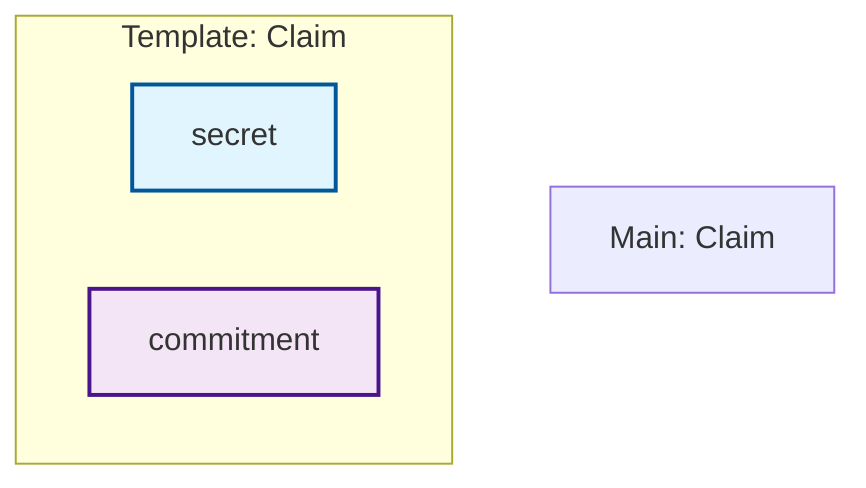

# Circuit Visualization with Mermaid

This document describes the Mermaid-based circuit visualization system that generates interactive diagrams for all Circom circuits in the project.

## Overview

The circuit visualization system analyzes all `.circom` files in the `circuits/` directory and generates Mermaid diagrams showing:

- **Flow Charts**: Detailed view of templates, signals, and components
- **Architecture Diagrams**: High-level view of component relationships and dependencies
- **Data Flow Diagrams**: Simplified view of input/output signal flow

## Usage

### Generate Visualizations

Run the visualization generator:

```bash
npm run visualize-circuit
```

This will:
1. Parse all `.circom` files in the `circuits/` directory
2. Generate Mermaid diagrams for each circuit
3. Create an HTML viewer at `docs/circuit_visualizations/index.html`

### View Visualizations

Open the generated HTML file in a web browser:

```bash
open docs/circuit_visualizations/index.html
```

The viewer provides:
- Interactive tabs to switch between diagram types
- Copy buttons to extract Mermaid code
- Table of contents for easy navigation
- Circuit statistics (templates, components, signals, connections)

### Use Mermaid Code

Copy the generated Mermaid code and paste it into:
- [Mermaid Live Editor](https://mermaid.live/)
- GitHub README files (native Mermaid support)
- Documentation tools supporting Mermaid
- IDE extensions with Mermaid preview

## Circuit Analysis

### Supported Circuit Elements

The parser extracts and visualizes:

- **Templates**: Reusable circuit components with parameters
- **Components**: Instantiated templates within circuits
- **Signals**: Input, output, and private signals
- **Connections**: Signal assignments and constraints
- **Includes**: Dependencies on other circuit files

### Diagram Types

#### 1. Flow Charts (`flowchart TD`)
- Shows detailed circuit structure
- Displays all signals with type-based styling
- Groups elements by templates using subgraphs
- Color-coded nodes (inputs: blue, outputs: purple, components: green)

#### 2. Architecture Diagrams (`graph LR`)
- Focuses on component relationships
- Shows dependencies between templates
- Highlights include relationships
- Useful for understanding overall system structure

#### 3. Data Flow Diagrams (`flowchart LR`)
- Simplified view of signal flow
- Emphasizes input → processing → output patterns
- Good for understanding circuit logic flow

## Implementation

### Core Components

1. **CircomParser** (`scripts/circom_parser.js`)
   - Parses Circom syntax to extract structural information
   - Handles templates, components, signals, and connections
   - Supports array signals and parameterized templates

2. **MermaidConverter** (`scripts/mermaid_converter.js`)
   - Converts parsed circuit data to Mermaid syntax
   - Generates different diagram types
   - Applies styling and layout optimizations

3. **CircuitVisualizer** (`scripts/generate_circuit_visualization.js`)
   - Orchestrates the parsing and conversion process
   - Generates HTML viewer with interactive features
   - Processes all circuits in the repository

### Parsing Strategy

The parser uses regular expressions to extract:
- Template definitions with parameters
- Signal declarations with types and arrays
- Component instantiations
- Signal connections and constraints
- Include statements

### Limitations

- Complex signal operations may not be fully captured
- Dynamic indexing is simplified in the visualization
- Some advanced Circom features may need custom handling

## Circuits Analyzed

The system currently processes these main circuits:

### Core Circuits
- `policy_privacy_main.circom` - Main privacy-preserving circuit
- `policy_privacy_main_instance.circom` - Production instance

### Interpreters
- `postfix_policy_interpreter.circom` - Policy evaluation engine
- `postfix_policy_interpreter_legacy.circom` - Legacy version

### Gadgets
- `commitment.circom` - Basic commitment functionality
- `policy_commitment.circom` - Policy-specific commitments
- `external_predicates.circom` - External verification components
- `multimux.circom` - Multiplexer utility

## Examples

### Sample Mermaid Code



### Circuit Statistics

Each circuit shows:
- 🏗️ Number of templates
- 🧩 Number of components  
- 📡 Number of signals
- 🔗 Number of connections

## Integration

### Package.json Script

The visualization is integrated as an npm script:

```json
{
  "scripts": {
    "visualize-circuit": "node scripts/generate_circuit_visualization.js"
  }
}
```

### Build Process

The visualization can be run independently or as part of documentation generation. It doesn't require circuit compilation and works with source `.circom` files directly.

## Future Enhancements

Potential improvements:
- Interactive Mermaid rendering with CDN fallbacks
- Export to SVG/PNG formats
- Integration with circuit compilation metrics
- Real-time updates during development
- More detailed constraint visualization
- Support for additional diagram types (sequence, state charts)