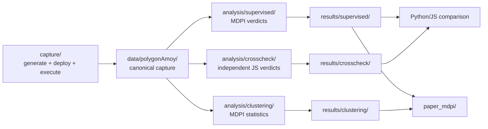

# Experiment and analysis pipeline

This document defines the active MDPI evaluation workflow. All capture,
analysis, and result artifacts now live under `experiments/`; the repository no
longer maintains a separate top-level Python experiment tree.

## Responsibility map

| Area | Responsibility |
|---|---|
| `experiments/capture/` | Policy generation orchestration, deployment, transactions, receipt collection, artifact slicing, and capture validation |
| `experiments/data/polygonAmoy/` | Committed source-of-record PCH/PI/SPP capture |
| `experiments/core/` | JavaScript infrastructure shared by capture and cross-check runners |
| `experiments/analysis/supervised/` | Authoritative MDPI LR/RF supervised attacks and verdicts |
| `experiments/analysis/clustering/` | Authoritative clustering, debiasing, bootstrap statistics, and figures |
| `experiments/analysis/crosscheck/` | Independent JavaScript PCH/PI/SPP verdict implementation |
| `experiments/results/` | Active supervised, clustering, cross-check, capture-validation, and legacy outputs |
| `experiments/ablation/gas_padding/` | B1/B2 on-chain artifacts, gas measurements, and ablation orchestration |
| `experiments/legacy/` | Broad historical sanity checks; not a manuscript source of record |

Historical captures under `experiments/unified/archive/`, the old PCH
`results_archive/` and `polygonAmoy_before_groupsplit/` folders, and
`experiments/multiseed_results/` are frozen provenance. They are not active
pipeline entry points.

## Data flow



The canonical capture is read directly. Regenerable clustering intermediates,
including `pi_pairs_balanced.json`, are written to the ignored
`experiments/.work/` tree rather than copied into a second dataset directory.

## Source-of-record rules

- Dataset: `experiments/data/polygonAmoy/`.
- MDPI supervised verdicts: `experiments/results/supervised/`.
- MDPI clustering tables and figures: `experiments/results/clustering/`.
- Independent JavaScript reports: `experiments/results/crosscheck/`.
- Gas-padding cost evidence: `experiments/ablation/gas_padding/`.

The IEEE manuscript under `paper/` retains its historical choice of JavaScript
verdicts. Do not mix those report values with MDPI tables without updating the
table and its provenance comment together.

## Commands

Create a root Python environment once:

```bash
python3 -m venv .venv
.venv/bin/pip install -r experiments/requirements.txt
```

Generate a new capture only when chain interaction is intended:

```bash
npm run data:generate:local
npm run data:generate:amoy
```

Both commands pin `PROTOCOL_CIRCUITS_DIR` to the frozen release under
`build/protocol/v3.0.0-rc1/circuits`, which is the zkey the checked-in
`PolicyPrivacyMainVerifier.sol` was exported from. `build/circuits` is a
working build directory and may hold a different phase-2 setup; a proof made
with a mismatched zkey is rejected on-chain (every access is denied) without any
local error, so run `npm run verify:artifacts` before any capture that invokes
`experiments/capture/run.js` directly. The capture records the circuits
directory and zkey SHA-256 in `metadata.json` provenance.

Validate the current DUO V3 generation configuration without submitting any
transactions:

```bash
npm run unified:validate
```

Rebuild the active analysis and independent check:

```bash
npm run analysis:all
npm run crosscheck:all
npm run analysis:compare:js
```

Run the complete offline reproduction or the fast provenance check:

```bash
npm run evaluation:reproduce
npm run evaluation:verify
```

The former is computationally expensive but does not submit transactions. The
legacy `analysis:python:*`, `crosscheck:js:*`, `unified*`, and `exp:*` npm names
remain compatibility aliases; direct references to the removed `python/` paths
are not supported.

## Protocol and capture versions

The active capture generator now targets the production DUO V3 layout:
`PolicyPrivacyMain(13, 11, 64, 5, 8, 32)`. It uses the canonical 13-attribute
order, the 11 fixed predicate slots, profile-derived requester attributes, a
signed `DUO_PROFILE` credential at slot 10, and eight-level ontology Merkle
evidence. DUO V3 rejects `NOT`, so new generation excludes the historical
`negation_heavy` SPP category. Because every term in the active experiment
vocabulary binds either an ontology predicate or the profile predicate, the
historical `predicateCount=none` category is also unreachable for new captures.

The committed Amoy capture in `experiments/data/polygonAmoy/` predates those
changes. Updating the generator does not make that dataset a DUO V3 capture.
`evaluation:verify` intentionally retains the provenance warning until a fresh
Amoy capture is explicitly run, validated, and promoted to source of record.
