# Experiment Pipeline Relationship

This diagram summarizes how the unified pipeline, the three JavaScript experiment modules, and the Python analysis layer relate to each other.

```mermaid
flowchart LR
    subgraph SharedCore["Shared JS foundations"]
        direction TB
        DG["policy_content_hiding/data_generator.js<br/>base dataset generation and execution"]
        SPPMeta["structure_and_parameter_privacy/data_generator.js<br/>SPP annotation and balance metadata"]
    end

    subgraph Unified["Unified entry"]
        direction TB
        U["experiments/unified/run.js<br/>validate, annotate, execute once"]
    end

    subgraph Artifacts["Shared dataset artifacts"]
        direction TB
        Defs["policy_definitions.json"]
        Exec["executed_dataset.json"]
        PCH["pch_dataset.json"]
        SPP["spp_dataset.json"]
        PI["pi_dataset.json"]
    end

    subgraph Pairing["PI pair construction"]
        direction TB
        PIPairBuilder["policy_indistinguishability/pi_data_generator.js<br/>build pairs from executed PI data"]
        Pairs["pi_pairs.json"]
    end

    subgraph PythonLayer["Independent Python attack (clustering cross-check)"]
        direction TB
        PyRunner["python/run_policy_privacy_experiments.py<br/>independent sklearn attack + clustering cross-check, visualize"]
        PyOutput["python/policy_privacy_report.json<br/>plots and aggregated metrics"]
    end

    subgraph JSExperiments["Authoritative JS verdict runners"]
        direction TB
        PCHRunner["policy_content_hiding/run_experiment.js<br/>calls core/multiseed_criterion.js — authoritative PCH verdict"]
        SPPRunner["structure_and_parameter_privacy/run_experiment.js<br/>calls core/multiseed_criterion.js — authoritative SPP verdict"]
        PIRunner["policy_indistinguishability/run_experiment.js<br/>calls core/multiseed_criterion.js — authoritative PI verdict"]
    end

    subgraph AblationLayer["Attack-pipeline validity"]
        direction TB
        Ablation["experiments/ablation/gas_padding/<br/>B1 unpadded vs B2 padded — same features/splits/classifiers"]
    end

    DG --> U
    SPPMeta --> U

    U --> Defs
    U --> Exec
    U --> PCH
    U --> SPP
    U --> PI

    PI --> PIPairBuilder
    Exec --> PIPairBuilder
    PIPairBuilder --> Pairs

    PCH --> PyRunner
    SPP --> PyRunner
    Pairs --> PyRunner
    PyRunner --> PyOutput

    Defs --> PCHRunner
    PCH --> PCHRunner

    Defs --> SPPRunner
    SPP --> SPPRunner

    Defs --> PIRunner
    Pairs --> PIRunner

    style SharedCore fill:#eefbea,stroke:#4f8a3e,stroke-width:2px
    style Unified fill:#e5f7de,stroke:#4f8a3e,stroke-width:2px
    style Artifacts fill:#f1faec,stroke:#4f8a3e,stroke-width:2px
    style Pairing fill:#edf8ee,stroke:#4f8a3e,stroke-width:2px
    style JSExperiments fill:#e5f7de,stroke:#4f8a3e,stroke-width:2px
    style PythonLayer fill:#eaf3f8,stroke:#3e6f8a,stroke-width:2px
    style AblationLayer fill:#fff6e0,stroke:#b58a34,stroke-width:2px

    classDef core fill:#dff4d8,stroke:#4f8a3e,color:#183116,stroke-width:1.5px
    classDef unified fill:#d8f0cf,stroke:#4f8a3e,color:#183116,stroke-width:1.5px
    classDef artifact fill:#e8f6e1,stroke:#4f8a3e,color:#183116,stroke-width:1.5px
    classDef pairing fill:#e2f2e4,stroke:#4f8a3e,color:#183116,stroke-width:1.5px
    classDef authoritative fill:#d8f0cf,stroke:#4f8a3e,color:#183116,stroke-width:1.5px
    classDef python fill:#d9e9f2,stroke:#3e6f8a,color:#132734,stroke-width:1.5px
    classDef ablation fill:#faedc9,stroke:#b58a34,color:#3a2c08,stroke-width:1.5px

    class DG,SPPMeta core
    class U unified
    class Defs,Exec,PCH,SPP,PI artifact
    class PIPairBuilder,Pairs pairing
    class PCHRunner,SPPRunner,PIRunner authoritative
    class PyRunner,PyOutput python
    class Ablation ablation
```

## Reading the diagram

- The unified pipeline is the main data-preparation entry point. It generates one shared dataset, validates it, executes it on-chain once, and writes experiment-specific artifact files.
- **The JS `run_experiment.js` runners are the authoritative path, not legacy.** Each one calls
  `evaluateMultiseed`/`printVerdict` from `experiments/core/multiseed_criterion.js` — the
  30-seed policy-disjoint double-criterion verdict that the paper (`paper/sec_pi.tex`,
  `sec_pch.tex`, `sec_spp.tex`) reports as PASS/FAIL. This diagram previously reversed this
  relationship and labeled these runners "legacy."
- **The Python layer is an independent, parallel attack implementation** (its own
  scikit-learn LR/RF/train-test-split pipeline; it does not read or depend on
  `multiseed_criterion.js`'s output), used for the unsupervised clustering cross-check
  (Section~4's "unsupervised pipeline") and additional plotting/reporting — it does not
  supersede or aggregate the JS verdicts.
- **Attack-pipeline validity is established separately**, by the gas-padding ablation
  (`experiments/ablation/gas_padding/`): the same features/splits/classifiers recover signal
  on the un-padded (B1) profile and lose it after padding (B2), rather than by any synthetic
  positive-control label.
- PI is slightly different from PCH and SPP because it inserts an explicit pair-construction
  stage before its JS verdict runner.
