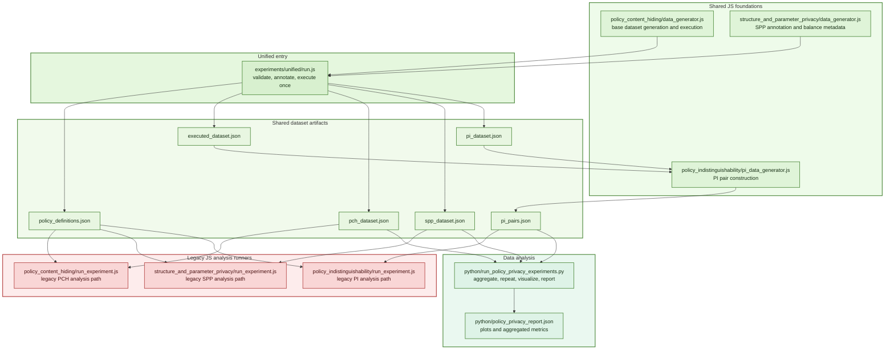

# Experiment Pipeline Relationship

This diagram summarizes how the unified pipeline, the three JavaScript experiment modules, and the Python analysis layer relate to each other.

## Reading the diagram

- The unified pipeline is the main data-preparation entry point. It generates one shared dataset, validates it, executes it on-chain once, and writes experiment-specific artifact files.
- The PCH, SPP, and PI directories still contain experiment-specific attack and evaluation logic, but the JavaScript analysis runners shown above are now legacy paths rather than the main workflow.
- The Python layer sits after the JavaScript pipelines. It consumes dataset artifacts and PI pairs to run repeated offline analysis, plotting, and final report aggregation.
- PI is slightly different from PCH and SPP because it needs an extra pair-construction step before attack analysis.
