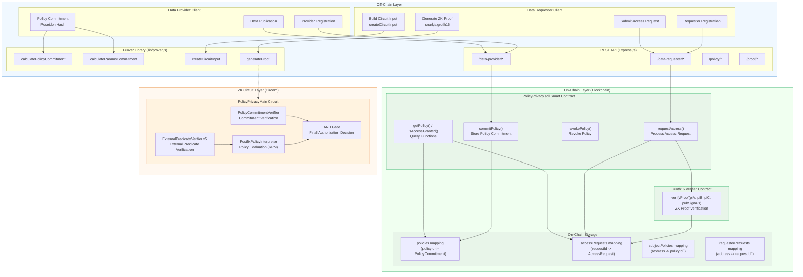
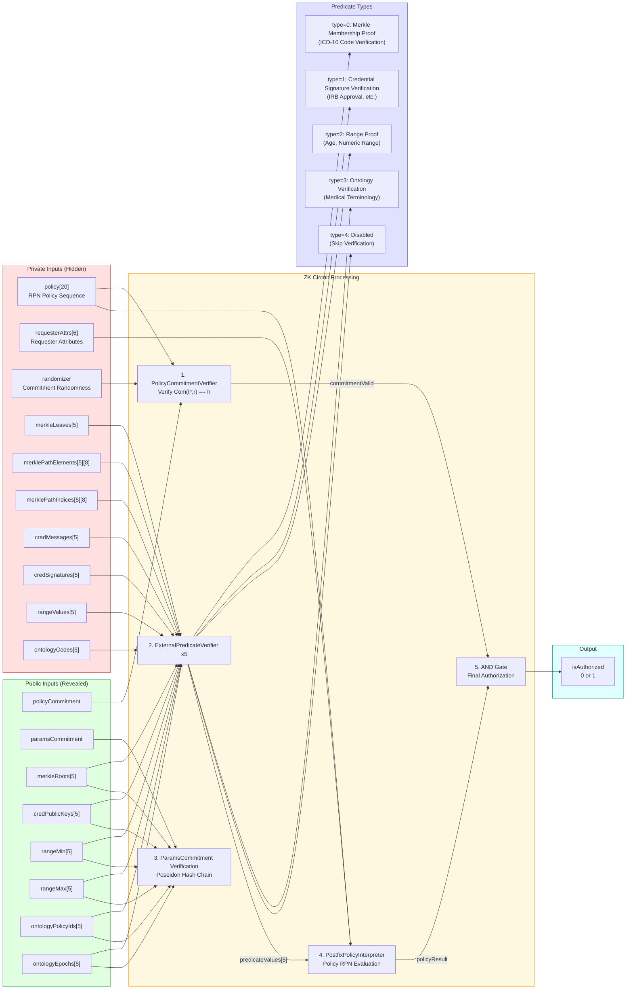
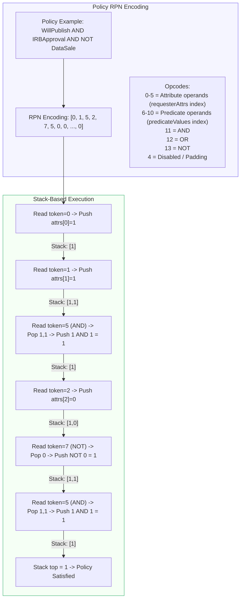
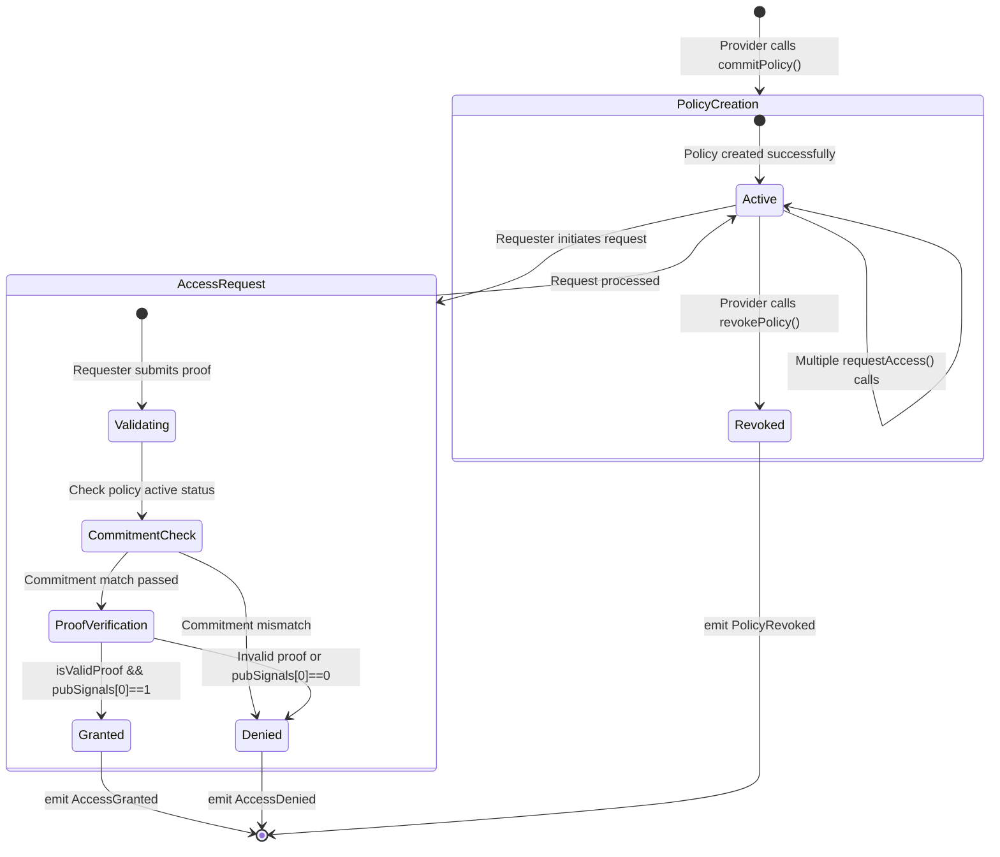
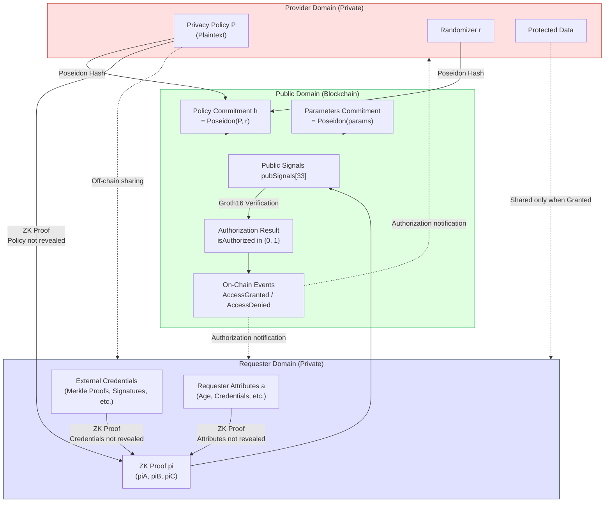
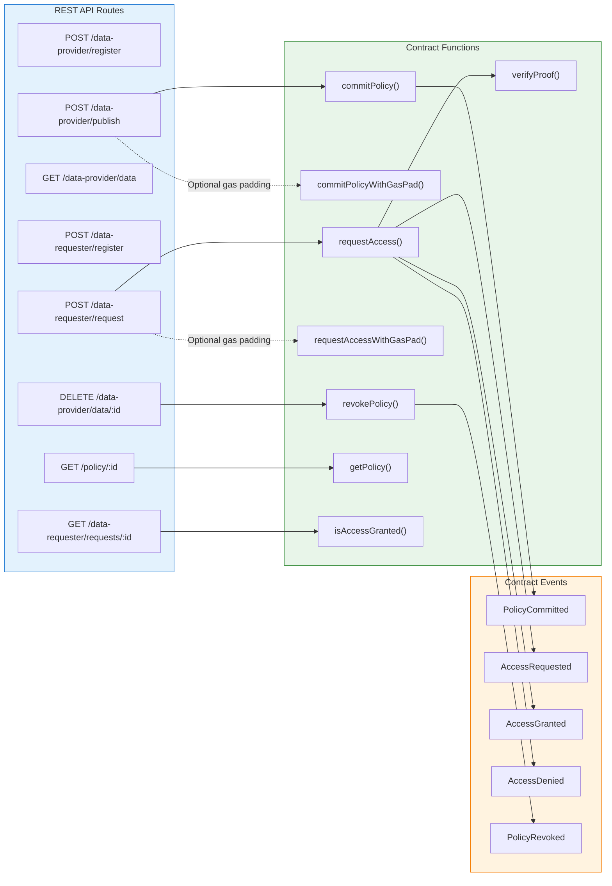

# Data Provider & Data Requester Interaction Flow

## 1. Full Interaction Sequence Diagram

```mermaid
sequenceDiagram
    autonumber
    participant P as Data Provider
    participant API as REST API<br/>(Express.js)
    participant Lib as Prover Library<br/>(lib/prover.js)
    participant SC as Smart Contract<br/>(PolicyPrivacy.sol)
    participant V as Verifier Contract<br/>(Groth16 Verifier)
    participant R as Data Requester

    %% ========== Phase 1: Policy Commitment ==========
    rect rgb(255, 245, 230)
        Note over P, Lib: Phase 1: Policy Commitment (Provider Local)

        P ->> Lib: calculatePolicyCommitment(policy, randomizer)
        Note right of Lib: Policy RPN encoding:<br/>"WillPublish AND IRBApproval"<br/>-> [0, 1, 5, 0, ..., 0]
        Lib ->> Lib: Poseidon(Poseidon(Policy), r)
        Lib -->> P: policyCommitment (hash)

        P ->> Lib: calculateParamsCommitment(merkleRoots,<br/>credKeys, rangeMin, rangeMax, ...)
        Lib ->> Lib: Poseidon hash chain<br/>over all external parameters
        Lib -->> P: paramsCommitment (hash)
    end

    %% ========== Phase 2: On-chain Policy Publication ==========
    rect rgb(230, 255, 230)
        Note over P, SC: Phase 2: On-Chain Policy Publication

        P ->>+ API: POST /data-provider/publish<br/>{providerAddress, dataHash,<br/>policyCommitment, paramsCommitment,<br/>metadataURI}
        API ->>+ SC: commitPolicy(commitment,<br/>paramsCommitment, metadataURI)
        SC ->> SC: Store PolicyCommitment{<br/>  dataSubject, commitment,<br/>  paramsCommitment, isActive,<br/>  timestamp, metadataURI<br/>}
        SC -->>- API: emit PolicyCommitted<br/>(dataSubject, policyId,<br/>commitment, paramsCommitment)
        API -->>- P: {dataId, policyId,<br/>transactionHash, gasUsed}
    end

    %% ========== Phase 3: Off-chain policy sharing ==========
    rect rgb(255, 230, 255)
        Note over P, R: Phase 3: Off-Chain Policy Sharing

        P -->> R: Share policy content P<br/>and randomizer r via off-chain channel
        R ->>+ API: Query published data<br/>GET /data-provider/data
        API -->>- R: {policyId, policyCommitment, ...}
    end

    %% ========== Phase 4: ZK Proof Generation ==========
    rect rgb(255, 255, 220)
        Note over R, Lib: Phase 4: ZK Proof Generation (Requester Local)

        R ->> Lib: createCircuitInput(policyCommitment, {<br/>  policy, requesterAttrs, randomizer,<br/>  predicateTypes, merkleLeaves,<br/>  credMessages, rangeValues, ...})
        Lib -->> R: circuitInput (structured)

        R ->> Lib: generateProof(circuitInput,<br/>{wasmPath, zkeyPath})
        Note right of Lib: ZK Circuit execution:<br/>1. Commitment verify Com(P;r)=h<br/>2. External predicate verify (Merkle/Sig/Range)<br/>3. Policy evaluation C(P,(a,p))=1<br/>4. Final auth = commitment OK AND policy OK
        Lib ->> Lib: snarkjs.groth16.fullProve()
        Lib -->> R: {pA, pB, pC, pubSignals[33]}
    end

    %% ========== Phase 5: On-chain Access Request ==========
    rect rgb(255, 230, 230)
        Note over R, V: Phase 5: On-Chain Access Request & Verification

        R ->>+ API: POST /data-requester/request<br/>{requesterAddress, policyId,<br/>proof: {pA, pB, pC, pubSignals}}
        API ->> API: validateProofFormat(proof)
        API ->>+ SC: requestAccess(policyId,<br/>pA, pB, pC, pubSignals)
        SC ->> SC: require(policy.isActive)
        SC ->> SC: require(pubSignals[1] == commitment)<br/>require(pubSignals[2] == paramsCommitment)
        SC ->>+ V: verifyProof(pA, pB, pC, pubSignals)
        V ->> V: Groth16 pairing check<br/>e(piA, piB) = e(alpha,beta) * e(vk,gamma) * e(piC,delta)
        V -->>- SC: isValidProof (bool)
        SC ->> SC: isAuthorized = isValidProof<br/>AND (pubSignals[0] == 1)

        alt isAuthorized == true
            SC -->> API: emit AccessGranted<br/>(requester, policyId, requestId)
        else isAuthorized == false
            SC -->> API: emit AccessDenied<br/>(requester, policyId, requestId)
        end
        SC -->>- API: requestId
        API -->>- R: {status: 'granted'/'denied',<br/>contractRequestId, transactionHash}
    end

    %% ========== Phase 6: Data Sharing ==========
    rect rgb(240, 240, 240)
        Note over P, R: Phase 6: Result Query & Data Sharing

        R ->>+ API: GET /data-requester/requests/:id
        API -->>- R: {status, contractDetails}

        P ->>+ API: GET /policy/:id/access-requests
        API -->>- P: Audit log [{requester, status, timestamp}]

        alt Access Granted
            P -->> R: Share protected data
        end
    end
```

## 2. System Architecture Diagram



## 3. ZK Circuit Internal Flow



## 4. Policy Evaluation Engine (Policy Interpreter)



## 5. Smart Contract State Diagram



## 6. Data Flow & Privacy Boundary



## 7. API Routes & Contract Functions Mapping


