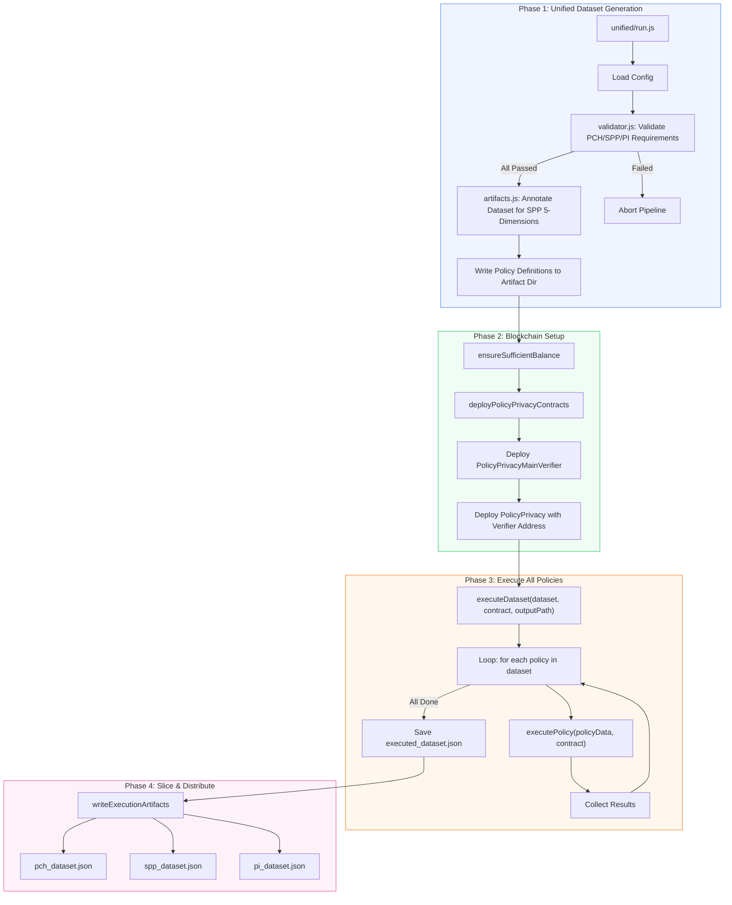
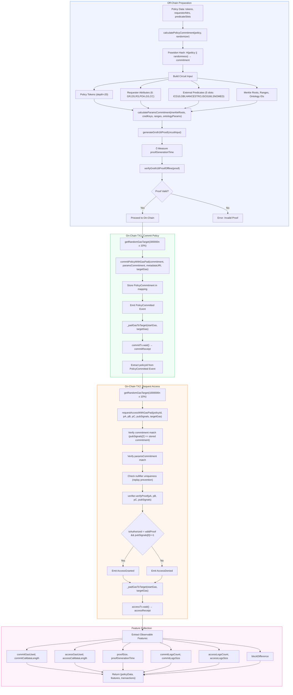
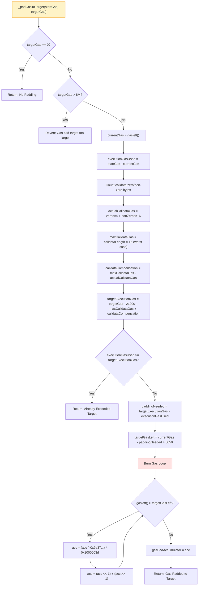
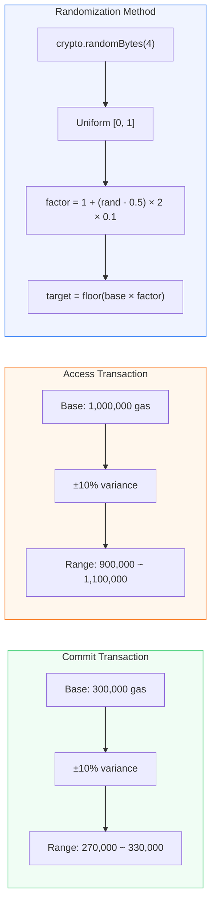
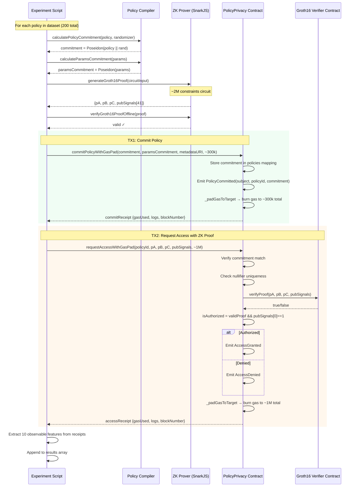
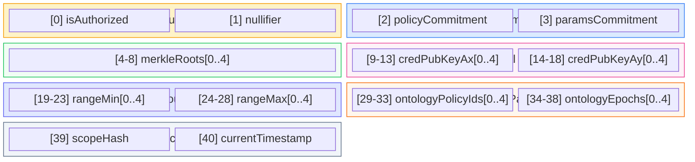
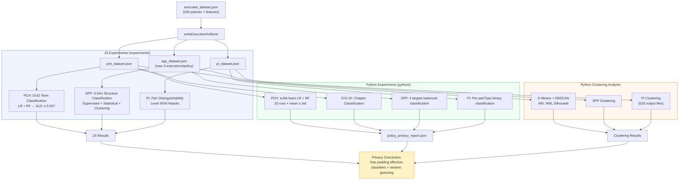

# On-Chain Execution Flow

## Overview

本文档详细描述了链上执行流程的每一个步骤，包括其实现逻辑和设计动机。

整个链上执行管线的目标是：将隐私策略（privacy policy）部署到区块链上，通过零知识证明（Groth16）验证请求者是否满足策略要求，同时通过 gas padding 机制防止攻击者通过观察交易的 gas 消耗来推断策略内容。执行完成后，收集 10 个可观测特征（observable features），供下游三个隐私实验（PCH、SPP、PI）评估 gas padding 的有效性。

所有 Mermaid 图源文件存放在 [diagrams/](diagrams/) 目录中。

---

## 1. End-to-End Pipeline（端到端流程）

[Source: diagrams/end_to_end_pipeline.mmd](diagrams/end_to_end_pipeline.mmd)



### Phase 1: Unified Dataset Generation（统一数据集生成）

**做什么：** 加载配置文件，验证数据集质量，并为 SPP 实验标注结构维度。

**详细步骤：**

1. **Load Config（加载配置）：** 从 JSON 配置文件读取策略定义，包括每个策略的 DUO 术语（Data Use Ontology）、请求者属性、谓词槽位等。配置文件定义了需要生成多少策略、每种 DUO 术语的分布比例等参数。

2. **Validate PCH/SPP/PI Requirements（验证三个实验的数据需求）：** 调用 `validator.js` 检查数据集是否满足三个下游实验的最低要求：
   - **PCH 验证：** 检查每个 DUO 术语至少有 20 个策略，且最大/最小数量比 ≥ 0.4，确保 DUO 术语分布均衡。**为什么：** PCH 实验需要对 7 种 DUO 术语进行分类，如果某种术语样本过少，分类器的评估结果就不可靠。
   - **SPP 验证：** 检查 5 个结构维度（逻辑结构、嵌套深度、谓词数量、集合大小、范围宽度）每个类别至少 15 个样本，变异系数 ≤ 0.6。**为什么：** SPP 实验需要评估攻击者能否从链上特征推断策略结构，样本不均衡会导致结果偏差。
   - **PI 验证：** 检查每种语义对类型（语义等价、弱等价、受控差异）至少 30 对，语义多样性 ≥ 0.6。**为什么：** PI 实验需要足够的策略对来评估不可区分性。

3. **Annotate Dataset for SPP 5-Dimensions（SPP 五维标注）：** 调用 `artifacts.js` 的 `annotateDatasetForSPP()` 为每个策略计算 5 个结构维度分类：
   - `logicStructure`：AND_ONLY / OR_ONLY / MIXED / NEGATION_HEAVY
   - `nestingDepth`：FLAT / SHALLOW / MEDIUM / DEEP
   - `predicateCount`：NONE / SINGLE / FEW / MANY
   - `setSize`：NONE / SMALL / MEDIUM / LARGE
   - `rangeWidth`：NONE / NARROW / MEDIUM / WIDE

   **为什么：** 这些维度是 SPP 实验的分类目标——如果攻击者无法从 gas 特征推断出这些维度，就说明策略结构隐私得到了保护。

4. **Write Policy Definitions（写入策略定义）：** 将标注后的策略定义写入 artifact 目录，作为后续执行的输入。

### Phase 2: Blockchain Setup（区块链环境准备）

**做什么：** 确保账户余额充足，部署智能合约。

**详细步骤：**

1. **ensureSufficientBalance（检查余额）：** 估算全部策略执行所需的总 gas 费用，与账户余额比较。估算公式：
   ```
   基础 gas = 部署费用(4.5M) + 策略数 × (提交费用 250K + 访问费用 750K)
   总估算 = 基础 gas × 1.25（25% 缓冲）
   ```
   **为什么：** 200 个策略的完整执行需要消耗大量 gas。如果账户余额不足，执行到一半失败会浪费已消耗的 gas 和时间。预检查可以在执行前就发现问题。

2. **Deploy PolicyPrivacyMainVerifier（部署验证器合约）：** 首先部署 Groth16 验证器合约（由 SnarkJS 根据电路自动生成）。这个合约包含椭圆曲线配对验证逻辑，能够在链上验证零知识证明的有效性。

3. **Deploy PolicyPrivacy with Verifier Address（部署主合约）：** 部署 `PolicyPrivacy` 主合约，将验证器合约地址作为构造参数传入。**为什么：** 采用两个合约分离的架构是因为验证器逻辑由电路编译器自动生成，主合约负责业务逻辑（策略提交、访问控制、gas padding），两者解耦便于独立升级。

### Phase 3: Execute All Policies（执行所有策略）

**做什么：** 遍历数据集中的每个策略，逐一执行链上提交和访问流程，收集可观测特征。

**详细步骤：**

1. **executeDataset：** 循环遍历数据集中的所有策略（通常 200 个），对每个策略调用 `executePolicy()`。采用逐个执行而非批量执行的方式，因为每个策略需要独立的证明生成和两笔交易。

2. **executePolicy：** 每个策略经历完整的 commit-then-access 生命周期（详见下一节）。

3. **Collect Results：** 每个策略执行后收集 10 个可观测特征和交易回执。如果某个策略执行失败，记录错误但继续执行后续策略。**为什么：** 鲁棒的批处理设计确保个别失败不会中断整个实验。

4. **Save executed_dataset.json：** 将所有执行结果保存为 JSON 文件，包含策略数据、特征值、交易回执等完整信息。

### Phase 4: Slice & Distribute（切片与分发）

**做什么：** 将统一执行结果按实验需求切分为三个独立数据集。

**详细步骤：**

1. **pch_dataset.json：** 包含所有策略的完整执行结果。**为什么：** PCH（Policy Content Hiding）实验需要所有策略的 gas 特征来训练分类器，尝试从 gas 消耗推断 DUO 术语。

2. **spp_dataset.json：** 每个策略最多保留前 3 次执行结果。**为什么：** SPP（Structure & Parameter Privacy）实验限制每个策略的执行次数，防止攻击者通过多次观察同一策略来积累统计信息，从而推断策略结构。

3. **pi_dataset.json：** 包含所有执行结果。**为什么：** PI（Policy Indistinguishability）实验需要完整数据来构建策略对，评估不同策略在链上是否不可区分。

---

## 2. Single Policy Execution Detail（单策略执行详情）

[Source: diagrams/single_policy_execution.mmd](diagrams/single_policy_execution.mmd)



### Off-Chain Preparation（链下准备阶段）

这个阶段在本地完成所有计算密集型操作，包括承诺计算、电路输入构建、证明生成和验证。**为什么在链下完成：** 这些操作计算量大（电路约 200 万个约束），在链上执行不可行且成本极高。链下完成后只需将证明提交到链上做轻量级验证。

**详细步骤：**

1. **calculatePolicyCommitment（计算策略承诺）：** 将策略内容（tokens）与一个随机数（randomizer）拼接后，使用 Poseidon 哈希计算承诺值 `commitment = Poseidon(policy || randomizer)`。
   - **为什么使用承诺方案：** 承诺值是策略内容的密码学摘要，在不泄露策略原文的前提下，允许链上合约验证策略的一致性。随机数的加入保证即使两个相同的策略也会产生不同的承诺值，防止攻击者通过比对承诺值推断策略是否相同。
   - **为什么使用 Poseidon 哈希：** Poseidon 是专为零知识证明电路优化的哈希函数，在 ZK 电路中的约束数远少于 SHA-256 或 Keccak，大幅降低证明生成的计算成本。

2. **Build Circuit Input（构建电路输入）：** 将策略的各项参数组装为电路所需的输入格式：
   - **Policy Tokens (depth=20)：** 策略的逻辑表达式以后缀表示法（postfix）编码为 token 数组，最大深度 20 层。包含 DUO 术语标识符、逻辑运算符（AND/OR/NOT）等。**为什么限制深度：** 电路是固定大小的，深度 20 足以覆盖实际医疗隐私策略的复杂度，同时控制电路规模。
   - **Requester Attributes (6 个)：** 请求者的 6 个 DUO 属性值——GR（通用研究）、DS（疾病特定）、RS（研究特定）、POA（人群祖源）、GS（地理限制）、CC（临床护理）。**为什么是 6 个：** 电路参数 N=6 限制了属性数量，覆盖了 DUO 规范中的核心属性（商业使用 CU 因 N 限制被排除）。
   - **External Predicates (5 slots)：** 5 个外部谓词槽位，分别对应 5 个本体标准：ICD-10（疾病分类）、OBI（生物医学调查）、HANCESTRO（人类祖源）、ISO 3166（国家地区）、SNOMED CT（临床术语）。每个槽位包含 Merkle 证明、范围约束、凭证公钥和本体 ID。**为什么使用 5 个槽位：** 电路参数 M=5，每个槽位对应一种本体谓词，允许策略灵活组合不同的本体约束。未使用的槽位填充零值。
   - **Merkle Roots, Ranges, Ontology IDs：** 外部参数的汇总，用于后续的参数承诺计算。

3. **calculateParamsCommitment（计算参数承诺）：** 将 Merkle 根、凭证公钥、范围边界、本体参数等外部参数哈希为一个承诺值 `paramsCommitment`。**为什么需要单独的参数承诺：** 策略承诺绑定策略逻辑，参数承诺绑定验证参数。分离设计允许在不改变策略逻辑的情况下更新参数（如更新 Merkle 树），同时确保链上合约能验证证明使用了正确的参数。

4. **generateGroth16Proof（生成 Groth16 零知识证明）：** 使用 SnarkJS 库，基于电路输入生成零知识证明。证明包含三个椭圆曲线点 (pA, pB, pC) 和 41 个公开信号（pubSignals）。电路约有 200 万个约束。
   - **为什么使用 Groth16：** Groth16 证明体积小（约 3 个椭圆曲线点 ≈ 256 字节）、链上验证快（一次配对运算），适合以太坊环境。缺点是需要可信设置（trusted setup），但对于固定电路结构是可接受的。
   - **为什么记录 proofGenerationTime：** 证明生成时间是可观测特征之一，攻击者理论上可以通过观察时间推断策略复杂度，因此需要评估该特征是否泄漏信息。

5. **verifyGroth16ProofOffline（链下验证证明）：** 在提交到链上之前，先在本地验证证明的正确性。**为什么：** 链上提交交易需要消耗 gas，如果证明无效，提交会失败但 gas 已经消耗。链下预验证可以避免因无效证明导致的 gas 浪费。

### On-Chain TX1: Commit Policy（链上交易 1：提交策略）

这是策略生命周期的第一笔链上交易，将策略承诺注册到合约中。

**详细步骤：**

1. **getRandomGasTarget（生成随机 gas 目标）：** 以 300,000 gas 为基准，施加 ±10% 的随机偏差，产生 270,000 ~ 330,000 范围内的目标值。使用 `crypto.randomBytes(4)` 生成密码学安全的随机数。**为什么需要随机化：** 如果所有策略的提交交易都 pad 到完全相同的 gas 值，攻击者可能通过统计分析发现模式。随机化在目标值上添加噪声，增加攻击者推断的难度。

2. **commitPolicyWithGasPad（带 gas padding 的策略提交）：** 合约函数，接收策略承诺、参数承诺、元数据 URI 和 gas 目标值。
   - **记录起始 gas：** `uint256 startGas = gasleft()`，用于后续计算需要 pad 多少 gas。
   - **执行 _commitPolicy()：** 递增策略 ID 计数器，将策略存入 `policies` mapping（包含 commitment、paramsCommitment、所有者等信息），触发 `PolicyCommitted` 事件。
   - **执行 _padGasToTarget()：** 将交易总 gas 消耗 pad 到目标值（详见 Gas Padding 机制章节）。

3. **commitTx.wait()：** 等待交易被区块链确认，获取交易回执（包含 gasUsed、logs、blockNumber 等信息）。

4. **Extract policyId：** 从 `PolicyCommitted` 事件中解析出链上分配的策略 ID。**为什么从事件提取：** 策略 ID 由合约内部计数器生成，调用者事先不知道，需要从事件日志中获取，用于后续的访问请求。

### On-Chain TX2: Request Access（链上交易 2：请求访问）

这是策略生命周期的第二笔链上交易，提交零知识证明来请求数据访问授权。

**详细步骤：**

1. **getRandomGasTarget（生成随机 gas 目标）：** 以 1,000,000 gas 为基准，施加 ±10% 的随机偏差，产生 900,000 ~ 1,100,000 范围内的目标值。**为什么访问交易的 gas 目标更高：** 访问交易需要执行 Groth16 证明验证（椭圆曲线配对运算），计算量远大于策略提交，需要更高的 gas 预算。

2. **requestAccessWithGasPad（带 gas padding 的访问请求）：** 合约函数，接收策略 ID、Groth16 证明 (pA, pB, pC) 和 41 个公开信号。合约内部执行以下验证：

3. **Verify commitment match（验证承诺匹配）：** 检查 `pubSignals[2]`（证明中的策略承诺）是否与合约存储的 commitment 一致。**为什么：** 确保证明是为链上注册的策略生成的，防止攻击者提交为其他策略生成的证明。

4. **Verify paramsCommitment match（验证参数承诺匹配）：** 检查 `pubSignals[3]` 是否与存储的 paramsCommitment 一致。**为什么：** 确保证明使用了正确的外部参数（Merkle 根、范围约束等），防止参数被篡改。

5. **Check nullifier uniqueness（检查 nullifier 唯一性）：** 检查 `pubSignals[1]`（nullifier）是否已被使用过，如果是则拒绝。将 nullifier 标记为已使用。**为什么：** Nullifier 是每次证明生成时产生的唯一标识符。如果没有 nullifier 检查，攻击者可以重放（replay）同一个证明来多次请求访问。这是零知识证明系统中防止双重使用的标准机制。

6. **verifier.verifyProof（链上验证零知识证明）：** 调用独立的 Groth16 验证器合约，执行椭圆曲线配对运算来验证证明的数学正确性。**为什么使用独立合约：** 验证器代码由 SnarkJS 从电路编译结果自动生成，与业务逻辑分离便于维护。

7. **Determine isAuthorized（判定授权结果）：** `isAuthorized = validProof && pubSignals[0] == 1`。要求证明有效 **且** 电路输出的授权信号为 1（表示请求者满足策略要求）。
   - 如果授权通过：触发 `AccessGranted` 事件
   - 如果授权拒绝：触发 `AccessDenied` 事件

   **为什么需要两个条件：** 即使证明本身有效（数学正确），也不代表请求者满足策略——电路可能正确地计算出"不满足"的结果（pubSignals[0] = 0）。

8. **_padGasToTarget（gas padding）：** 将交易总 gas 消耗 pad 到目标值。**关键隐私保护：** 无论策略的授权结果是 Grant 还是 Deny，gas 消耗都被 pad 到相同的目标范围。这防止攻击者通过比较 gas 消耗来推断授权结果或策略内容。

9. **accessTx.wait()：** 等待交易确认，获取交易回执。

### Feature Collection（特征收集阶段）

**做什么：** 从两笔交易的回执中提取 10 个攻击者可观测的链上特征。

**为什么收集这些特征：** 在真实的区块链环境中，任何人都可以查看交易的 gas 消耗、calldata 大小、事件日志等信息。这 10 个特征代表了攻击者能获取的全部链上可观测信息。如果 ML 分类器无法从这些特征中推断出策略内容（AUC ≤ 0.55），则证明 gas padding 机制有效地保护了策略隐私。

**10 个可观测特征详解：**

| 特征 | 含义 | 为什么可观测 | 潜在泄漏风险 |
|------|------|-------------|-------------|
| `commitGasUsed` | 提交交易的总 gas 消耗 | 区块链上所有交易的 gas 消耗公开可见 | 策略复杂度可能影响 gas 消耗 |
| `commitCalldataLength` | 提交交易的 calldata 字节长度 | 交易数据公开可见 | calldata 大小可能反映参数数量 |
| `accessGasUsed` | 访问交易的总 gas 消耗 | 同上 | 证明验证复杂度可能不同 |
| `accessCalldataLength` | 访问交易的 calldata 字节长度 | 同上 | 证明大小可能与策略复杂度相关 |
| `proofSize` | Groth16 证明的字节大小（含 padding） | 证明作为 calldata 提交，公开可见 | 未 padding 时大小可能不同 |
| `proofGenerationTime` | 证明生成耗时 | 链下指标，攻击者通过时序分析可能观测 | 复杂策略可能需要更长的生成时间 |
| `commitLogsCount` | 提交交易触发的事件数量 | 事件日志公开可见 | 通常为 1（PolicyCommitted） |
| `commitLogsSize` | 提交交易事件日志的总字节数 | 事件 payload 公开可见 | 事件参数大小可能不同 |
| `accessLogsCount` | 访问交易触发的事件数量 | 事件日志公开可见 | 通常 2-3 个（AccessRequested + Grant/Deny + NullifierUsed） |
| `accessLogsSize` | 访问交易事件日志的总字节数 | 事件 payload 公开可见 | 不同事件组合的 payload 大小不同 |
| `blockDifference` | 提交与访问交易之间的区块差 | 区块号公开可见 | 时间间隔可能暗示策略处理复杂度 |

---

## 3. Gas Padding Mechanism（Gas Padding 机制）

[Source: diagrams/gas_padding_mechanism.mmd](diagrams/gas_padding_mechanism.mmd)



### Gas Padding 的核心问题

**为什么需要 Gas Padding：** 在以太坊中，每笔交易的 gas 消耗是公开可见的。不同策略因为逻辑复杂度不同（谓词数量、嵌套深度、集合大小等），其提交和验证交易的 gas 消耗会有差异。攻击者可以通过分析 gas 消耗模式推断策略内容，形成侧信道攻击。Gas Padding 的目标是让所有交易的 gas 消耗"看起来一样"，消除这个侧信道。

### 详细步骤解释

1. **targetGas == 0? （检查是否需要 padding）：** 如果目标值为 0，跳过 padding。这允许在不需要隐私保护的场景下（如测试）禁用 padding。

2. **targetGas > 8M? （安全上限检查）：** 如果目标值超过 800 万 gas，交易回退（revert）。**为什么：** 以太坊区块 gas limit 约 3000 万，单笔交易消耗过多 gas 会影响区块打包，8M 是保守的安全限制。

3. **executionGasUsed = startGas - currentGas（计算已消耗 gas）：** 用函数入口的 gas 余量减去当前的 gas 余量，得到策略操作实际消耗的 gas。

4. **Calldata 补偿计算（关键创新）：** 这一步解决了 EVM gas 计费的一个细节问题：
   - 以太坊对 calldata 中的零字节收费 4 gas，非零字节收费 16 gas（EIP-2028）
   - 不同策略的 calldata 中零字节和非零字节的比例不同
   - 如果只 pad 执行 gas 而不补偿 calldata gas 差异，总 gas 消耗仍会因 calldata 内容不同而不同

   **计算过程：**
   - `actualCalldataGas`：扫描 `msg.data` 的每个字节，计算实际 calldata gas 费用
   - `maxCalldataGas`：假设所有字节都是非零（最坏情况），计算最大可能费用
   - `calldataCompensation`：最大费用与实际费用的差值

   **为什么这样做：** 通过将补偿值加入执行 gas 目标，确保"实际 calldata gas + 实际执行 gas + padding gas"的总和等于"最坏情况 calldata gas + 目标执行 gas"。这样无论 calldata 内容如何，总 gas 消耗都一致。

5. **targetExecutionGas = targetGas - 21000 - maxCalldataGas + calldataCompensation（计算执行 gas 目标）：**
   - `21000`：EVM 固定交易基础费用（EIP-3529），每笔交易都收取，不可避免
   - `maxCalldataGas`：扣除 calldata gas 预算
   - `calldataCompensation`：加回实际节省的 calldata gas

   **结果：** 得到"纯执行部分"需要达到的 gas 目标。

6. **executionGasUsed >= targetExecutionGas?（检查是否已超标）：** 如果策略操作本身消耗的 gas 已经超过目标，无法 pad（无法"减少" gas 消耗），直接返回。**为什么可能超标：** 某些极复杂的策略可能消耗超过预设基准的 gas。这种情况下 gas padding 失效，但实际发生概率极低（基准值设定时已考虑最大复杂度）。

7. **paddingNeeded = targetExecutionGas - executionGasUsed（计算需要 pad 的 gas 量）：** 目标值减去实际消耗，得到需要额外燃烧的 gas 量。

8. **targetGasLeft = currentGas - paddingNeeded + 5050（计算目标剩余 gas）：** 预留 5050 gas 用于循环退出后的操作：约 5000 gas 用于 `gasPadAccumulator` 的存储写入（SSTORE），约 50 gas 用于循环退出和函数返回。

9. **Burn Gas Loop（gas 燃烧循环）：** 执行无意义的数学运算直到 gas 余量降到目标值：
   - `acc = (acc ^ 0x9e37...) * 0x1000003d`：XOR 和乘法运算
   - `acc = (acc << 1) + (acc >> 1)`：位移和加法运算

   **为什么选择这些运算：**
   - 每次迭代消耗约 30-40 gas，粒度较细，能精确控制 gas 消耗
   - 使用了不同类型的运算（XOR、乘法、位移），EVM 编译器无法将其优化掉
   - 累加器 `acc` 写入状态变量 `gasPadAccumulator`，产生副作用（SSTORE），确保编译器不会将整个循环优化为死代码

---

## 4. Gas Target Randomization（Gas 目标随机化）

[Source: diagrams/gas_target_randomization.mmd](diagrams/gas_target_randomization.mmd)



### 为什么需要随机化

Gas Padding 将交易 gas 消耗 pad 到目标值，但如果所有交易都 pad 到完全相同的固定值（如恰好 300,000），这本身就是一个可识别的模式。攻击者会注意到所有提交交易的 gas 消耗完全相同，从而推断系统使用了 gas padding，并尝试更精细的统计攻击。

随机化在目标值上添加均匀分布的噪声，使得 gas 消耗呈现自然的波动模式，与区块链上的正常交易 gas 变化更加接近。

### 随机化方法详解

1. **crypto.randomBytes(4)：** 生成 4 字节（32 位）的密码学安全随机数。**为什么用密码学随机数：** 普通的 `Math.random()` 是伪随机数，攻击者可能预测序列。`crypto.randomBytes` 使用操作系统的熵源，不可预测。

2. **Uniform [0, 1]：** 将 4 字节整数转换为 [0, 1] 区间的均匀分布浮点数：`random = bytes.readUInt32BE() / 0xFFFFFFFF`。

3. **factor = 1 + (rand - 0.5) × 2 × 0.1：** 计算缩放因子：
   - `rand - 0.5`：偏移到 [-0.5, 0.5]
   - `× 2 × 0.1`：缩放到 [-0.1, 0.1]
   - `1 +`：偏移到 [0.9, 1.1]

   最终 factor 在 0.9 到 1.1 之间均匀分布。

4. **target = floor(base × factor)：** 将基准值乘以缩放因子并取整。

### 参数选择理由

- **Commit 基准 300K：** 策略提交的实际 gas 消耗约 150K-250K，300K 提供足够的 padding 空间。
- **Access 基准 1M：** 访问请求需要执行 Groth16 验证（约 200K-400K gas），加上证明数据处理和事件触发，1M 提供充足的 padding 余量。
- **±10% 方差：** 足以产生有意义的噪声，但不会过大导致 gas 浪费严重或 padding 空间不足。

---

## 5. Contract Interaction Sequence（合约交互时序）

[Source: diagrams/contract_interaction_sequence.mmd](diagrams/contract_interaction_sequence.mmd)



### 交互流程解读

上图展示了实验脚本与各组件之间的完整交互序列。对于数据集中的每个策略（共 200 个），重复以下流程：

**链下阶段（Script ↔ Compiler ↔ Prover）：**

- 实验脚本调用 **Policy Compiler**（策略编译器）计算两个承诺值。编译器负责将策略定义转换为电路可处理的格式，并使用 Poseidon 哈希生成承诺。
- 实验脚本调用 **ZK Prover**（SnarkJS）生成零知识证明。Prover 加载预编译的电路（约 200 万约束），运行 witness 计算和证明生成算法，输出证明和 41 个公开信号。
- 实验脚本在本地验证证明有效性，确保提交到链上前证明是正确的。

**链上阶段（Script → Contract → Verifier）：**

- **TX1（绿色区域）：** 脚本向 PolicyPrivacy 合约提交策略承诺。合约将承诺存入状态变量，触发事件，执行 gas padding，返回回执。整个过程不涉及验证器合约——提交阶段只需要注册承诺。
- **TX2（橙色区域）：** 脚本向 PolicyPrivacy 合约提交零知识证明。合约首先进行内部检查（承诺匹配、nullifier 唯一性），然后调用独立的 **Groth16 Verifier** 合约验证证明的数学正确性。验证器返回布尔值后，合约根据验证结果和电路输出决定授权，触发相应事件，执行 gas padding。

**为什么分为两笔交易：** Commit-then-access 模式确保策略必须先注册再验证，防止前置攻击（front-running）。如果合并为一笔交易，矿工可能在看到提交内容后拦截或操纵。两笔交易的分离也使得策略注册和访问验证在逻辑上独立，允许一个策略被多次验证。

---

## 6. Public Signals Layout（公开信号布局，41 个信号）

[Source: diagrams/public_signals_layout.mmd](diagrams/public_signals_layout.mmd)



### 公开信号详解

零知识证明系统中，公开信号（public signals）是证明中不被隐藏的部分，链上合约和任何观察者都可以看到。电路的 41 个公开信号按功能分为 7 组：

**Outputs（输出，2 个）：**
- **[0] isAuthorized：** 电路的核心输出。值为 1 表示请求者满足策略要求，值为 0 表示不满足。**为什么公开：** 合约需要知道授权结果来决定触发 AccessGranted 还是 AccessDenied 事件。
- **[1] nullifier：** 由策略和请求者的秘密输入确定性生成的唯一标识符。**为什么公开：** 合约需要检查 nullifier 是否已被使用，防止证明重放攻击。

**Commitments（承诺，2 个）：**
- **[2] policyCommitment：** 策略内容的 Poseidon 哈希承诺。**为什么公开：** 合约需要比对该值与存储的承诺，确保证明对应正确的策略。承诺本身不泄漏策略内容（Poseidon 哈希的单向性）。
- **[3] paramsCommitment：** 外部验证参数的承诺。**为什么公开：** 确保证明使用了策略注册时指定的参数，防止参数替换攻击。

**Merkle Roots（Merkle 根，5 个）：**
- **[4-8] merkleRoots[0..4]：** 5 个外部谓词的 Merkle 树根。每个根对应一个本体标准（ICD-10、OBI、HANCESTRO、ISO 3166、SNOMED CT）的成员集合。**为什么公开：** 合约需要验证证明使用了正确的 Merkle 树（即正确的白名单/黑名单集合）。Merkle 根本身不泄漏集合中的具体成员。

**Credential Keys（凭证公钥，10 个）：**
- **[9-13] credPubKeyAx[0..4]：** 5 个凭证签发者公钥的 x 坐标。
- **[14-18] credPubKeyAy[0..4]：** 5 个凭证签发者公钥的 y 坐标。
- **为什么公开：** 这些公钥标识了受信任的凭证签发者（如医院、研究机构）。公开公钥不会泄漏请求者持有的凭证内容，但允许验证凭证确实由受信任方签发。

**Range Bounds（范围边界，10 个）：**
- **[19-23] rangeMin[0..4]：** 5 个谓词的范围下界。
- **[24-28] rangeMax[0..4]：** 5 个谓词的范围上界。
- **为什么公开：** 策略可能要求请求者的某个属性值在特定范围内（如 ICD-10 代码在某个章节范围内）。公开范围边界允许合约验证范围约束的正确性。**注意：** 这些范围是策略参数的一部分，公开范围可能泄漏部分策略信息，但这是在隐私和可验证性之间的权衡。

**Ontology Params（本体参数，10 个）：**
- **[29-33] ontologyPolicyIds[0..4]：** 5 个本体谓词的策略标识符。
- **[34-38] ontologyEpochs[0..4]：** 5 个本体谓词的纪元值（用于版本控制）。
- **为什么公开：** 本体标准会随时间更新（如 ICD-10 每年有新版本），epoch 允许合约验证证明使用的是正确版本的本体数据。

**Misc（杂项，2 个）：**
- **[39] scopeHash：** 作用域哈希，限定证明的使用范围。**为什么：** 防止在一个上下文中生成的证明被用于另一个上下文。
- **[40] currentTimestamp：** 证明生成时的时间戳。**为什么：** 允许合约检查证明是否在有效时间窗口内生成，防止使用过期证明。

---

## 7. Downstream Experiment Data Flow（下游实验数据流）

[Source: diagrams/downstream_data_flow.mmd](diagrams/downstream_data_flow.mmd)



### 数据流解读

链上执行完成后，200 个策略的执行结果（每个包含 10 个可观测特征）被写入 `executed_dataset.json`。然后通过 `writeExecutionArtifacts` 切片为三个实验专用数据集，分别输入三层实验分析体系：

### 三个隐私实验

**PCH（Policy Content Hiding，策略内容隐藏）：**
- **目标：** 评估攻击者能否从 gas 特征推断策略包含哪个 DUO 术语（7 分类问题）
- **方法：** 训练逻辑回归（LR）和随机森林（RF）分类器
- **通过标准：** AUC ≤ 0.55（接近随机猜测的 0.5）
- **为什么这是重要的：** 如果分类器无法区分不同 DUO 术语的策略，说明 gas padding 有效隐藏了策略内容

**SPP（Structure & Parameter Privacy，结构与参数隐私）：**
- **目标：** 评估攻击者能否从 gas 特征推断策略的结构属性（逻辑结构、嵌套深度等）
- **方法：** 三种攻击类型——监督学习（LR+RF）、统计检验（KS检验、MMD、置换检验）、聚类分析（K-means）
- **为什么使用多种攻击：** 单一攻击方法可能遗漏某些信息泄漏模式，多种方法交叉验证更可靠

**PI（Policy Indistinguishability，策略不可区分性）：**
- **目标：** 评估攻击者能否区分语义相似但结构不同的策略对
- **方法：** 三个等级——Level I（单样本分类）、Level II（配对/Siamese 网络，使用 delta 特征）、Level III（双样本统计检验）
- **为什么分层级：** 模拟不同能力的攻击者，从弱到强评估隐私保护的鲁棒性

### 三层分析体系

1. **JS Experiments（JavaScript 实验层）：** 使用自实现的 ML 算法（梯度下降 LR、Gini 不纯度决策树、10 棵树的 RF），与链上执行代码在同一代码库中，便于端到端测试。

2. **Python Experiments（Python 实验层）：** 使用 scikit-learn 的工业级 ML 实现，仅使用 2 个核心特征（commitGasUsed、accessGasUsed），20 次运行取均值±标准差，作为独立验证层。**为什么只用 2 个特征：** 专注于最可能泄漏信息的 gas 消耗特征，避免高维特征空间中的过拟合干扰结论。

3. **Python Clustering（聚类分析层）：** 使用 K-Means 和 DBSCAN 进行无监督聚类，评估 gas 特征是否自然形成与策略分类对应的簇。指标包括 ARI（调整兰德指数）、NMI（标准化互信息）和 Silhouette（轮廓系数）。**为什么需要聚类：** 即使监督学习无法分类，gas 特征也可能在特征空间中形成可识别的簇。聚类分析从另一个角度评估隐私。

### 最终结论

如果三层实验体系的所有指标都表明分类器接近随机猜测（AUC ≈ 0.5，advantage ≤ 0.05，ARI/NMI ≈ 0），则可以得出结论：**Gas padding 机制有效地保护了策略隐私，攻击者无法从链上可观测特征推断策略内容、结构或区分不同策略。**
