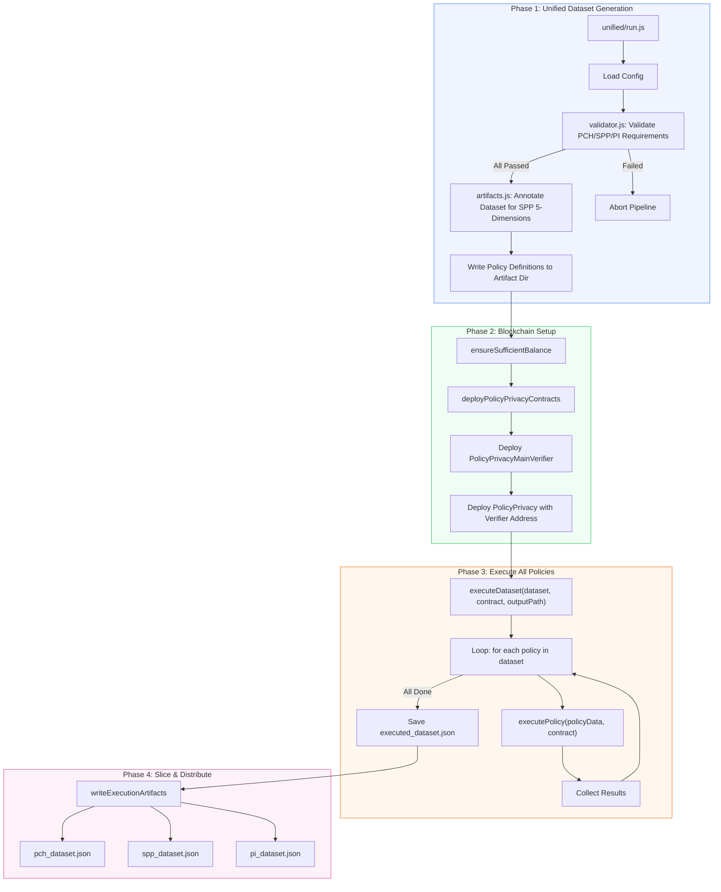
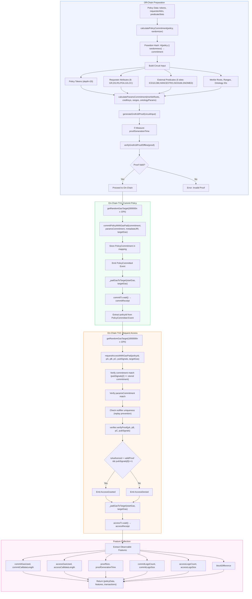
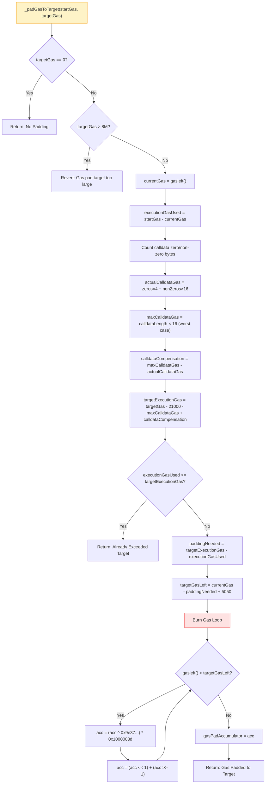
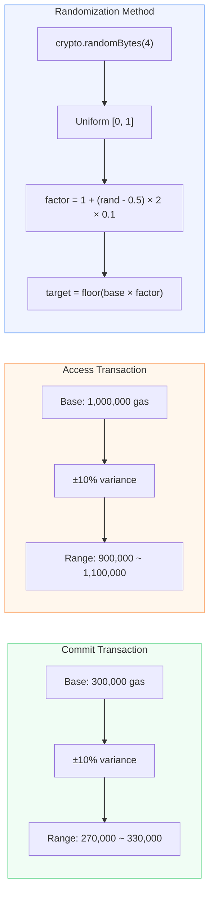
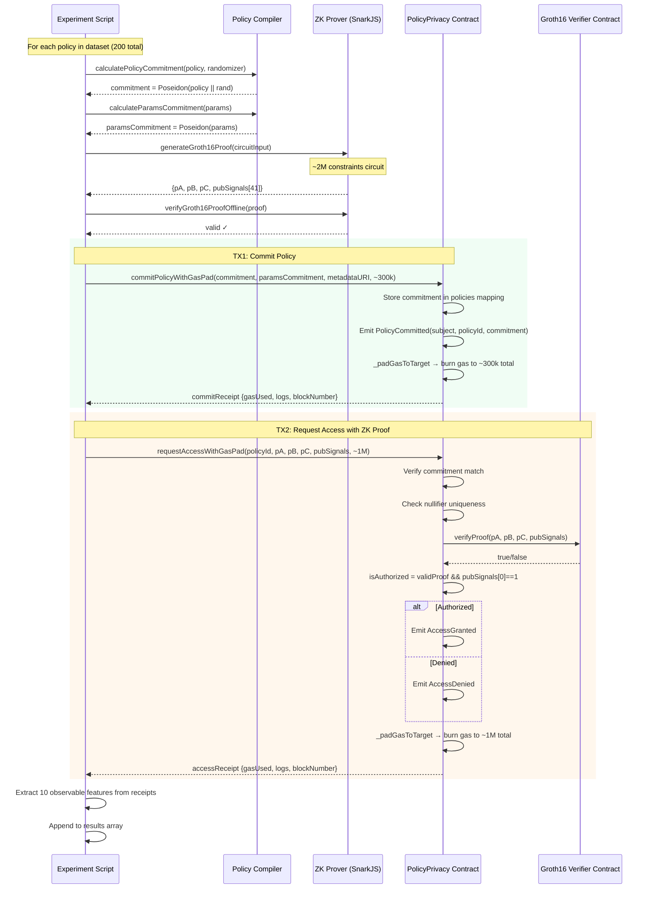
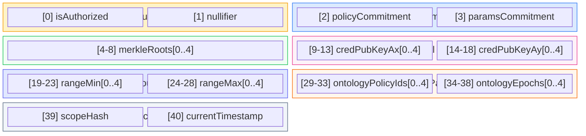
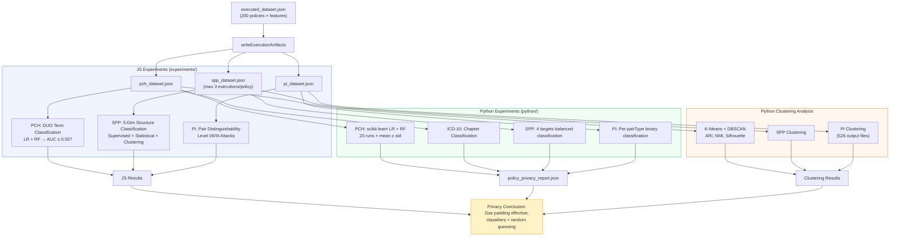

# On-Chain Execution Flow

## Overview

This document provides a detailed description of every step in the on-chain execution flow, including its implementation logic and design rationale.

The overall goal of the on-chain execution pipeline is to deploy privacy policies onto the blockchain, verify whether requesters satisfy policy requirements through zero-knowledge proofs (Groth16), and apply gas padding mechanisms to prevent attackers from inferring policy content by observing transaction gas consumption. After execution, 10 observable features are collected and fed into three downstream privacy experiments (PCH, SPP, PI) to evaluate the effectiveness of gas padding.

All Mermaid diagram source files are stored in [diagrams/](diagrams/).

---

## 1. End-to-End Pipeline

[Source: diagrams/end_to_end_pipeline.mmd](diagrams/end_to_end_pipeline.mmd)



### Phase 1: Unified Dataset Generation

**What it does:** Loads the configuration file, validates dataset quality, and annotates structural dimensions for the SPP experiment.

**Detailed steps:**

1. **Load Config:** Reads policy definitions from a JSON configuration file, including each policy's DUO terms (Data Use Ontology), requester attributes, predicate slots, and more. The configuration specifies how many policies to generate and the distribution ratio for each DUO term.

2. **Validate PCH/SPP/PI Requirements:** Invokes `validator.js` to verify that the dataset satisfies the minimum requirements of all three downstream experiments:
   - **PCH validation:** Ensures each DUO term has at least 20 policies and the max/min count ratio is >= 0.4, guaranteeing balanced DUO term distribution. **Why:** The PCH experiment classifies policies across 7 DUO terms. If any term has too few samples, the classifier evaluation becomes unreliable.
   - **SPP validation:** Checks that each category across 5 structural dimensions (logic structure, nesting depth, predicate count, set size, range width) has at least 15 samples, with a coefficient of variation <= 0.6. **Why:** The SPP experiment evaluates whether an attacker can infer policy structure from on-chain features. Imbalanced samples would bias the results.
   - **PI validation:** Verifies each semantic pair type (semantic equivalent, weak equivalent, controlled difference) has at least 30 pairs, with semantic diversity >= 0.6. **Why:** The PI experiment requires sufficient policy pairs to evaluate indistinguishability.

3. **Annotate Dataset for SPP 5-Dimensions:** Calls `annotateDatasetForSPP()` from `artifacts.js` to compute 5 structural dimension classifications for each policy:
   - `logicStructure`: AND_ONLY / OR_ONLY / MIXED / NEGATION_HEAVY
   - `nestingDepth`: FLAT / SHALLOW / MEDIUM / DEEP
   - `predicateCount`: NONE / SINGLE / FEW / MANY
   - `setSize`: NONE / SMALL / MEDIUM / LARGE
   - `rangeWidth`: NONE / NARROW / MEDIUM / WIDE

   **Why:** These dimensions serve as classification targets for the SPP experiment. If an attacker cannot infer these dimensions from gas features, it demonstrates that structural privacy is preserved.

4. **Write Policy Definitions:** Writes annotated policy definitions to the artifact directory as input for subsequent execution.

### Phase 2: Blockchain Setup

**What it does:** Ensures sufficient account balance and deploys smart contracts.

**Detailed steps:**

1. **ensureSufficientBalance:** Estimates the total gas cost for executing all policies and compares it against the account balance. Estimation formula:
   ```
   base gas = deployment(4.5M) + policyCount × (commit cost 250K + access cost 750K)
   total estimate = base gas × 1.25 (25% buffer)
   ```
   **Why:** Full execution of 200 policies consumes substantial gas. If the account balance is insufficient, a mid-execution failure wastes already-consumed gas and time. Pre-checking catches this problem before execution begins.

2. **Deploy PolicyPrivacyMainVerifier:** First deploys the Groth16 verifier contract (auto-generated by SnarkJS from the circuit). This contract contains elliptic curve pairing verification logic for on-chain zero-knowledge proof validation.

3. **Deploy PolicyPrivacy with Verifier Address:** Deploys the `PolicyPrivacy` main contract, passing the verifier contract address as a constructor parameter. **Why:** The two-contract architecture separates concerns: the verifier logic is auto-generated by the circuit compiler, while the main contract handles business logic (policy commitment, access control, gas padding). This decoupling allows independent upgrades.

### Phase 3: Execute All Policies

**What it does:** Iterates through every policy in the dataset, executing the on-chain commit-and-access flow for each one, and collects observable features.

**Detailed steps:**

1. **executeDataset:** Loops through all policies in the dataset (typically 200), calling `executePolicy()` for each one. Policies are executed sequentially rather than batched, as each policy requires independent proof generation and two separate transactions.

2. **executePolicy:** Each policy undergoes the complete commit-then-access lifecycle (detailed in the next section).

3. **Collect Results:** After each policy execution, 10 observable features and transaction receipts are collected. If a policy execution fails, the error is logged but subsequent policies continue. **Why:** Robust batch processing ensures individual failures do not interrupt the entire experiment.

4. **Save executed_dataset.json:** Saves all execution results as a JSON file, containing policy data, feature values, transaction receipts, and other complete information.

### Phase 4: Slice & Distribute

**What it does:** Partitions unified execution results into three separate datasets according to each experiment's requirements.

**Detailed steps:**

1. **pch_dataset.json:** Contains complete execution results for all policies. **Why:** The PCH (Policy Content Hiding) experiment needs gas features from all policies to train classifiers that attempt to infer DUO terms from gas consumption.

2. **spp_dataset.json:** Retains at most the first 3 executions per policy. **Why:** The SPP (Structure & Parameter Privacy) experiment limits executions per policy to prevent attackers from accumulating statistical information through repeated observations of the same policy, which could reveal structural patterns.

3. **pi_dataset.json:** Contains all execution results. **Why:** The PI (Policy Indistinguishability) experiment needs complete data to construct policy pairs and evaluate whether different policies are indistinguishable on-chain.

---

## 2. Single Policy Execution Detail

[Source: diagrams/single_policy_execution.mmd](diagrams/single_policy_execution.mmd)



### Off-Chain Preparation

This phase completes all computationally intensive operations locally, including commitment computation, circuit input construction, proof generation, and verification. **Why off-chain:** These operations are computationally heavy (the circuit has approximately 2 million constraints), making on-chain execution infeasible and prohibitively expensive. Once completed off-chain, only lightweight verification needs to happen on-chain.

**Detailed steps:**

1. **calculatePolicyCommitment:** Concatenates the policy content (tokens) with a random value (randomizer) and computes the commitment using Poseidon hash: `commitment = Poseidon(policy || randomizer)`.
   - **Why use a commitment scheme:** The commitment is a cryptographic digest of the policy content that allows the on-chain contract to verify policy consistency without revealing the original policy. The randomizer ensures that even two identical policies produce different commitment values, preventing attackers from comparing commitments to determine whether policies are the same.
   - **Why use Poseidon hash:** Poseidon is a hash function specifically optimized for zero-knowledge proof circuits. Its constraint count in ZK circuits is far lower than SHA-256 or Keccak, significantly reducing the computational cost of proof generation.

2. **Build Circuit Input:** Assembles the policy's various parameters into the format required by the circuit:
   - **Policy Tokens (depth=20):** The policy's logical expression is encoded in postfix notation as a token array with a maximum depth of 20 levels. It contains DUO term identifiers, logical operators (AND/OR/NOT), etc. **Why limit depth:** The circuit has a fixed size. A depth of 20 is sufficient to cover the complexity of real-world healthcare privacy policies while keeping the circuit size manageable.
   - **Requester Attributes (6):** The requester's 6 DUO attribute values -- GR (General Research), DS (Disease Specific), RS (Research Specific), POA (Population/Ancestry), GS (Geographical Restriction), CC (Clinical Care). **Why 6:** The circuit parameter N=6 limits the number of attributes, covering the core attributes in the DUO specification (Commercial Use/CU is excluded due to the N limit).
   - **External Predicates (5 slots):** 5 external predicate slots corresponding to 5 ontology standards: ICD-10 (disease classification), OBI (biomedical investigations), HANCESTRO (human ancestry), ISO 3166 (countries/regions), SNOMED CT (clinical terms). Each slot contains a Merkle proof, range constraints, credential public keys, and ontology IDs. **Why 5 slots:** The circuit parameter M=5 allocates one slot per ontology predicate, allowing policies to flexibly combine different ontological constraints. Unused slots are zero-filled.
   - **Merkle Roots, Ranges, Ontology IDs:** Aggregation of external parameters used for subsequent parameter commitment computation.

3. **calculateParamsCommitment:** Hashes the Merkle roots, credential public keys, range bounds, and ontology parameters into a single commitment value `paramsCommitment`. **Why a separate parameter commitment:** The policy commitment binds the policy logic, while the parameter commitment binds the verification parameters. This separation allows updating parameters (e.g., refreshing a Merkle tree) without changing the policy logic, while ensuring the on-chain contract can verify that the proof used the correct parameters.

4. **generateGroth16Proof:** Uses the SnarkJS library to generate a zero-knowledge proof based on the circuit input. The proof consists of three elliptic curve points (pA, pB, pC) and 41 public signals (pubSignals). The circuit has approximately 2 million constraints.
   - **Why Groth16:** Groth16 proofs are compact (approximately 3 elliptic curve points, around 256 bytes) and fast to verify on-chain (a single pairing operation), making them well-suited for the Ethereum environment. The downside is the requirement for a trusted setup, which is acceptable for a fixed circuit structure.
   - **Why record proofGenerationTime:** Proof generation time is one of the observable features. An attacker could theoretically observe timing to infer policy complexity, so this feature must be evaluated for information leakage.

5. **verifyGroth16ProofOffline:** Verifies the proof's correctness locally before submitting it on-chain. **Why:** Submitting a transaction on-chain consumes gas. If the proof is invalid, the submission will fail but the gas is already spent. Off-chain pre-verification avoids gas waste from invalid proofs.

### On-Chain TX1: Commit Policy

This is the first on-chain transaction in the policy lifecycle, registering the policy commitment in the contract.

**Detailed steps:**

1. **getRandomGasTarget:** Starting from a base of 300,000 gas, applies a +/-10% random variance, producing a target value in the range of 270,000 to 330,000. Uses `crypto.randomBytes(4)` for cryptographically secure randomness. **Why randomize:** If all policy commit transactions were padded to the exact same gas value, attackers could detect this pattern through statistical analysis. Randomization adds noise to the target value, making inference more difficult.

2. **commitPolicyWithGasPad:** A contract function that receives the policy commitment, parameter commitment, metadata URI, and gas target value.
   - **Record starting gas:** `uint256 startGas = gasleft()`, used later to calculate how much gas needs to be padded.
   - **Execute _commitPolicy():** Increments the policy ID counter, stores the policy in the `policies` mapping (including commitment, paramsCommitment, owner information), and emits a `PolicyCommitted` event.
   - **Execute _padGasToTarget():** Pads the total gas consumption of the transaction to the target value (see Gas Padding Mechanism section).

3. **commitTx.wait():** Waits for the transaction to be confirmed on the blockchain, obtaining a transaction receipt (containing gasUsed, logs, blockNumber, etc.).

4. **Extract policyId:** Parses the on-chain-assigned policy ID from the `PolicyCommitted` event. **Why extract from events:** The policy ID is generated by an internal counter in the contract. The caller does not know it in advance and must obtain it from the event logs for use in the subsequent access request.

### On-Chain TX2: Request Access

This is the second on-chain transaction in the policy lifecycle, submitting a zero-knowledge proof to request data access authorization.

**Detailed steps:**

1. **getRandomGasTarget:** Starting from a base of 1,000,000 gas, applies a +/-10% random variance, producing a target value in the range of 900,000 to 1,100,000. **Why is the access transaction gas target higher:** The access transaction must execute Groth16 proof verification (elliptic curve pairing operations), which is far more computationally expensive than policy commitment and requires a higher gas budget.

2. **requestAccessWithGasPad:** A contract function that receives the policy ID, Groth16 proof (pA, pB, pC), and 41 public signals. The contract internally performs the following verifications:

3. **Verify commitment match:** Checks that `pubSignals[2]` (the policy commitment in the proof) matches the commitment stored in the contract. **Why:** Ensures the proof was generated for the on-chain registered policy, preventing attackers from submitting proofs generated for a different policy.

4. **Verify paramsCommitment match:** Checks that `pubSignals[3]` matches the stored paramsCommitment. **Why:** Ensures the proof used the correct external parameters (Merkle roots, range constraints, etc.), preventing parameter tampering.

5. **Check nullifier uniqueness:** Checks whether `pubSignals[1]` (the nullifier) has already been used; if so, rejects the request. Marks the nullifier as used. **Why:** The nullifier is a unique identifier generated during each proof creation. Without nullifier checking, an attacker could replay the same proof to request access multiple times. This is the standard mechanism for preventing double-spending in zero-knowledge proof systems.

6. **verifier.verifyProof:** Calls the independent Groth16 verifier contract to perform elliptic curve pairing operations that verify the mathematical correctness of the proof. **Why a separate contract:** The verifier code is auto-generated by SnarkJS from the circuit compilation output. Separating it from business logic facilitates maintenance.

7. **Determine isAuthorized:** `isAuthorized = validProof && pubSignals[0] == 1`. Requires both that the proof is valid **and** the circuit's authorization output signal equals 1 (indicating the requester satisfies the policy requirements).
   - If authorized: emits an `AccessGranted` event
   - If denied: emits an `AccessDenied` event

   **Why two conditions are required:** Even if the proof itself is valid (mathematically correct), it does not mean the requester satisfies the policy -- the circuit may have correctly computed a "not satisfied" result (pubSignals[0] = 0).

8. **_padGasToTarget (gas padding):** Pads the total transaction gas consumption to the target value. **Critical privacy protection:** Regardless of whether the policy authorization result is Grant or Deny, gas consumption is padded to the same target range. This prevents attackers from comparing gas consumption to infer authorization results or policy content.

9. **accessTx.wait():** Waits for the transaction to be confirmed and obtains the transaction receipt.

### Feature Collection

**What it does:** Extracts 10 attacker-observable on-chain features from the two transaction receipts.

**Why collect these features:** In a real blockchain environment, anyone can view a transaction's gas consumption, calldata size, event logs, and other information. These 10 features represent the complete set of on-chain observable information available to an attacker. If ML classifiers cannot infer policy content from these features (AUC <= 0.55), it demonstrates that the gas padding mechanism effectively protects policy privacy.

**The 10 observable features explained:**

| Feature | Meaning | Why Observable | Potential Leakage Risk |
|---------|---------|---------------|----------------------|
| `commitGasUsed` | Total gas consumed by the commit transaction | Gas consumption of all blockchain transactions is publicly visible | Policy complexity may affect gas consumption |
| `commitCalldataLength` | Byte length of commit transaction calldata | Transaction data is publicly visible | Calldata size may reflect parameter count |
| `accessGasUsed` | Total gas consumed by the access transaction | Same as above | Proof verification complexity may vary |
| `accessCalldataLength` | Byte length of access transaction calldata | Same as above | Proof size may correlate with policy complexity |
| `proofSize` | Byte size of the Groth16 proof (including padding) | The proof is submitted as calldata, publicly visible | Size may differ without padding |
| `proofGenerationTime` | Time taken to generate the proof | Off-chain metric; attackers may observe via timing analysis | Complex policies may require longer generation time |
| `commitLogsCount` | Number of events emitted by the commit transaction | Event logs are publicly visible | Typically 1 (PolicyCommitted) |
| `commitLogsSize` | Total bytes of all event payloads for commit | Event payloads are publicly visible | Event parameter sizes may differ |
| `accessLogsCount` | Number of events emitted by the access transaction | Event logs are publicly visible | Typically 2-3 (AccessRequested + Grant/Deny + NullifierUsed) |
| `accessLogsSize` | Total bytes of event payloads for access | Event payloads are publicly visible | Different event combinations have different payload sizes |
| `blockDifference` | Block number difference between commit and access transactions | Block numbers are publicly visible | Time interval may hint at policy processing complexity |

---

## 3. Gas Padding Mechanism

[Source: diagrams/gas_padding_mechanism.mmd](diagrams/gas_padding_mechanism.mmd)



### The Core Problem Gas Padding Solves

**Why gas padding is needed:** In Ethereum, the gas consumption of every transaction is publicly visible. Different policies, due to varying logical complexity (predicate count, nesting depth, set size, etc.), produce different gas consumption in their commit and verification transactions. Attackers can analyze gas consumption patterns to infer policy content, forming a side-channel attack. The goal of gas padding is to make all transactions "look the same" in terms of gas consumption, eliminating this side channel.

### Detailed Step Explanation

1. **targetGas == 0? (Check whether padding is needed):** If the target value is 0, padding is skipped. This allows disabling padding in scenarios where privacy protection is not needed (e.g., testing).

2. **targetGas > 8M? (Safety cap check):** If the target exceeds 8 million gas, the transaction reverts. **Why:** The Ethereum block gas limit is approximately 30 million. A single transaction consuming too much gas would impact block packing. 8M is a conservative safety limit.

3. **executionGasUsed = startGas - currentGas (Calculate consumed gas):** Subtracts the current remaining gas from the gas at function entry to determine the gas actually consumed by policy operations.

4. **Calldata compensation calculation (key innovation):** This step addresses a subtlety in EVM gas accounting:
   - Ethereum charges 4 gas for zero bytes and 16 gas for non-zero bytes in calldata (EIP-2028)
   - Different policies have different ratios of zero to non-zero bytes in their calldata
   - If only execution gas is padded without compensating for calldata gas differences, total gas consumption will still vary based on calldata content

   **Calculation process:**
   - `actualCalldataGas`: Scans each byte of `msg.data` to compute the actual calldata gas cost
   - `maxCalldataGas`: Assumes all bytes are non-zero (worst case) to compute the maximum possible cost
   - `calldataCompensation`: The difference between the maximum cost and the actual cost

   **Why this approach:** By adding the compensation value to the execution gas target, it ensures that "actual calldata gas + actual execution gas + padding gas" equals "worst-case calldata gas + target execution gas". This way, total gas consumption is consistent regardless of calldata content.

5. **targetExecutionGas = targetGas - 21000 - maxCalldataGas + calldataCompensation (Calculate execution gas target):**
   - `21000`: The fixed base transaction fee in the EVM (EIP-3529), charged for every transaction and unavoidable
   - `maxCalldataGas`: Deducts the calldata gas budget
   - `calldataCompensation`: Adds back the gas actually saved on calldata

   **Result:** Yields the gas target for the "pure execution portion."

6. **executionGasUsed >= targetExecutionGas? (Check if already exceeded):** If the policy operation itself consumed more gas than the target, padding is impossible (gas consumption cannot be "reduced"), so it returns immediately. **Why this might happen:** Some extremely complex policies may consume more gas than the preset baseline. In this case, gas padding fails, but the probability is extremely low in practice (baseline values are set considering maximum complexity).

7. **paddingNeeded = targetExecutionGas - executionGasUsed (Calculate required padding amount):** The target minus actual consumption yields the amount of gas that needs to be additionally burned.

8. **targetGasLeft = currentGas - paddingNeeded + 5050 (Calculate target remaining gas):** Reserves 5050 gas for post-loop operations: approximately 5000 gas for the `gasPadAccumulator` storage write (SSTORE), and approximately 50 gas for loop exit and function return.

9. **Burn Gas Loop:** Executes meaningless mathematical operations until the gas remaining drops to the target value:
   - `acc = (acc ^ 0x9e37...) * 0x1000003d`: XOR and multiplication operations
   - `acc = (acc << 1) + (acc >> 1)`: Bit shift and addition operations

   **Why these specific operations:**
   - Each iteration consumes approximately 30-40 gas, providing fine granularity for precise gas consumption control
   - The mix of different operation types (XOR, multiplication, bit shift) prevents the EVM compiler from optimizing them away
   - The accumulator `acc` is written to the state variable `gasPadAccumulator`, creating a side effect (SSTORE) that ensures the compiler cannot optimize the entire loop as dead code

---

## 4. Gas Target Randomization

[Source: diagrams/gas_target_randomization.mmd](diagrams/gas_target_randomization.mmd)



### Why Randomization Is Needed

Gas padding normalizes transaction gas consumption to a target value, but if all transactions were padded to the exact same fixed value (e.g., exactly 300,000), this uniformity itself becomes a recognizable pattern. An attacker would notice that all commit transactions have identical gas consumption, infer that the system uses gas padding, and attempt more refined statistical attacks.

Randomization adds uniformly distributed noise to the target value, causing gas consumption to exhibit natural fluctuation patterns that more closely resemble the normal gas variation seen in blockchain transactions.

### Randomization Method Explained

1. **crypto.randomBytes(4):** Generates 4 bytes (32 bits) of cryptographically secure random data. **Why cryptographic randomness:** Standard `Math.random()` produces pseudo-random numbers whose sequence an attacker could potentially predict. `crypto.randomBytes` uses the operating system's entropy source and is unpredictable.

2. **Uniform [0, 1]:** Converts the 4-byte integer to a uniformly distributed floating-point number in the [0, 1] interval: `random = bytes.readUInt32BE() / 0xFFFFFFFF`.

3. **factor = 1 + (rand - 0.5) x 2 x 0.1:** Computes the scaling factor:
   - `rand - 0.5`: Shifts to [-0.5, 0.5]
   - `x 2 x 0.1`: Scales to [-0.1, 0.1]
   - `1 +`: Shifts to [0.9, 1.1]

   The final factor is uniformly distributed between 0.9 and 1.1.

4. **target = floor(base x factor):** Multiplies the base value by the scaling factor and truncates to an integer.

### Parameter Selection Rationale

- **Commit baseline 300K:** Actual gas consumption for policy commits is approximately 150K-250K. 300K provides sufficient headroom for padding.
- **Access baseline 1M:** Access requests require Groth16 verification (approximately 200K-400K gas), plus proof data processing and event emission. 1M provides ample padding margin.
- **+/-10% variance:** Sufficient to produce meaningful noise without being so large as to cause excessive gas waste or insufficient padding headroom.

---

## 5. Contract Interaction Sequence

[Source: diagrams/contract_interaction_sequence.mmd](diagrams/contract_interaction_sequence.mmd)



### Interaction Flow Explained

The diagram above illustrates the complete interaction sequence between the experiment script and each component. For every policy in the dataset (200 total), the following flow is repeated:

**Off-chain phase (Script <-> Compiler <-> Prover):**

- The experiment script calls the **Policy Compiler** to compute two commitment values. The compiler converts the policy definition into a circuit-processable format and generates commitments using Poseidon hash.
- The experiment script calls the **ZK Prover** (SnarkJS) to generate a zero-knowledge proof. The Prover loads the pre-compiled circuit (approximately 2 million constraints), runs witness computation and the proof generation algorithm, and outputs the proof along with 41 public signals.
- The experiment script verifies proof validity locally, ensuring the proof is correct before on-chain submission.

**On-chain phase (Script -> Contract -> Verifier):**

- **TX1 (green region):** The script submits the policy commitment to the PolicyPrivacy contract. The contract stores the commitment in state variables, emits events, executes gas padding, and returns the receipt. The verifier contract is not involved at this stage -- the commit phase only needs to register the commitment.
- **TX2 (orange region):** The script submits the zero-knowledge proof to the PolicyPrivacy contract. The contract first performs internal checks (commitment match, nullifier uniqueness), then calls the independent **Groth16 Verifier** contract to verify the mathematical correctness of the proof. After the verifier returns a boolean result, the contract determines authorization based on the verification result and circuit output, emits the corresponding event, and executes gas padding.

**Why two separate transactions:** The commit-then-access pattern ensures that a policy must be registered before it can be verified, preventing front-running attacks. If combined into a single transaction, miners could intercept or manipulate the submission after seeing its contents. The separation also makes policy registration and access verification logically independent, allowing a single policy to be verified multiple times.

---

## 6. Public Signals Layout (41 Signals)

[Source: diagrams/public_signals_layout.mmd](diagrams/public_signals_layout.mmd)



### Public Signals Explained

In a zero-knowledge proof system, public signals are the non-hidden portions of the proof that are visible to the on-chain contract and any observer. The circuit's 41 public signals are organized into 7 groups by function:

**Outputs (2):**
- **[0] isAuthorized:** The core output of the circuit. A value of 1 indicates the requester satisfies the policy requirements; 0 indicates they do not. **Why public:** The contract needs to know the authorization result to decide whether to emit an AccessGranted or AccessDenied event.
- **[1] nullifier:** A unique identifier deterministically generated from the policy and requester's secret inputs. **Why public:** The contract needs to check whether the nullifier has already been used, preventing proof replay attacks.

**Commitments (2):**
- **[2] policyCommitment:** The Poseidon hash commitment of the policy content. **Why public:** The contract needs to compare this value against the stored commitment to ensure the proof corresponds to the correct policy. The commitment itself does not leak policy content (due to the one-way nature of Poseidon hash).
- **[3] paramsCommitment:** The commitment of external verification parameters. **Why public:** Ensures the proof used the parameters specified at policy registration time, preventing parameter substitution attacks.

**Merkle Roots (5):**
- **[4-8] merkleRoots[0..4]:** The Merkle tree roots for 5 external predicates. Each root corresponds to the member set of an ontology standard (ICD-10, OBI, HANCESTRO, ISO 3166, SNOMED CT). **Why public:** The contract needs to verify the proof used the correct Merkle trees (i.e., the correct allowlist/denylist sets). Merkle roots alone do not reveal specific members in the set.

**Credential Keys (10):**
- **[9-13] credPubKeyAx[0..4]:** The x-coordinates of 5 credential issuer public keys.
- **[14-18] credPubKeyAy[0..4]:** The y-coordinates of 5 credential issuer public keys.
- **Why public:** These public keys identify trusted credential issuers (e.g., hospitals, research institutions). Making public keys visible does not leak the content of credentials held by the requester, but allows verification that credentials were indeed issued by trusted parties.

**Range Bounds (10):**
- **[19-23] rangeMin[0..4]:** The lower bounds for 5 predicate ranges.
- **[24-28] rangeMax[0..4]:** The upper bounds for 5 predicate ranges.
- **Why public:** Policies may require a requester's attribute value to fall within a specific range (e.g., ICD-10 codes within a certain chapter range). Making range bounds public allows the contract to verify range constraint correctness. **Note:** These ranges are part of the policy parameters. Making them public may leak partial policy information, but this is a trade-off between privacy and verifiability.

**Ontology Params (10):**
- **[29-33] ontologyPolicyIds[0..4]:** Policy identifiers for 5 ontology predicates.
- **[34-38] ontologyEpochs[0..4]:** Epoch values for 5 ontology predicates (used for version control).
- **Why public:** Ontology standards are updated over time (e.g., ICD-10 releases new versions annually). Epochs allow the contract to verify that the proof used the correct version of ontology data.

**Misc (2):**
- **[39] scopeHash:** A scope hash that restricts the proof's usage context. **Why:** Prevents a proof generated in one context from being used in another.
- **[40] currentTimestamp:** The timestamp when the proof was generated. **Why:** Allows the contract to check whether the proof was generated within a valid time window, preventing the use of expired proofs.

---

## 7. Downstream Experiment Data Flow

[Source: diagrams/downstream_data_flow.mmd](diagrams/downstream_data_flow.mmd)



### Data Flow Explained

After on-chain execution completes, the execution results for 200 policies (each containing 10 observable features) are written to `executed_dataset.json`. These are then sliced by `writeExecutionArtifacts` into three experiment-specific datasets, which feed into a three-tier experimental analysis framework:

### The Three Privacy Experiments

**PCH (Policy Content Hiding):**
- **Goal:** Evaluate whether an attacker can infer which DUO term a policy contains from gas features (a 7-class classification problem)
- **Method:** Train Logistic Regression (LR) and Random Forest (RF) classifiers
- **Pass criterion:** AUC <= 0.55 (close to random guessing at 0.5)
- **Why this matters:** If classifiers cannot distinguish policies with different DUO terms, it demonstrates that gas padding effectively hides policy content

**SPP (Structure & Parameter Privacy):**
- **Goal:** Evaluate whether an attacker can infer structural properties of a policy (logic structure, nesting depth, etc.) from gas features
- **Method:** Three attack types -- supervised learning (LR+RF), statistical tests (KS test, MMD, permutation tests), and clustering analysis (K-means)
- **Why multiple attack types:** A single attack method might miss certain information leakage patterns. Cross-validation with multiple methods is more reliable

**PI (Policy Indistinguishability):**
- **Goal:** Evaluate whether an attacker can distinguish semantically similar but structurally different policy pairs
- **Method:** Three levels -- Level I (single-sample classification), Level II (pairwise/Siamese network using delta features), Level III (two-sample statistical tests)
- **Why tiered levels:** Simulates attackers of varying capabilities, evaluating the robustness of privacy protection from weak to strong adversaries

### Three-Tier Analysis Framework

1. **JS Experiments (JavaScript experiment layer):** Uses custom-implemented ML algorithms (gradient descent LR, Gini impurity decision tree, 10-tree RF) within the same codebase as the on-chain execution code, enabling end-to-end testing.

2. **Python Experiments (Python experiment layer):** Uses scikit-learn's production-grade ML implementations with only 2 core features (commitGasUsed, accessGasUsed), averaged over 20 runs with mean +/- standard deviation, serving as an independent validation layer. **Why only 2 features:** Focuses on the features most likely to leak information (gas consumption), avoiding overfitting in high-dimensional feature spaces that could distort conclusions.

3. **Python Clustering (clustering analysis layer):** Uses K-Means and DBSCAN for unsupervised clustering, evaluating whether gas features naturally form clusters corresponding to policy classifications. Metrics include ARI (Adjusted Rand Index), NMI (Normalized Mutual Information), and Silhouette coefficient. **Why clustering is needed:** Even if supervised learning cannot classify, gas features might form identifiable clusters in feature space. Clustering analysis evaluates privacy from a different angle.

### Final Conclusion

If all metrics across the three-tier experimental framework indicate that classifiers perform near random guessing (AUC approximately 0.5, advantage <= 0.05, ARI/NMI approximately 0), the conclusion can be drawn that: **The gas padding mechanism effectively protects policy privacy, and attackers cannot infer policy content, structure, or distinguish different policies from on-chain observable features.**
